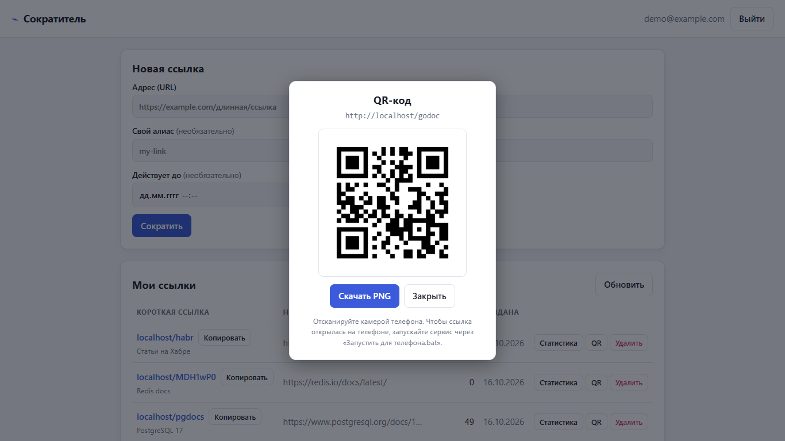

# Руководство пользователя

## 1 Назначение программы

«Сократитель ссылок» — веб-сервис, который превращает длинный адрес в короткий вида `http://localhost/abc1234` и собирает статистику переходов по нему: количество переходов и уникальных посетителей, страны, источники (с каких сайтов пришли), браузеры, операционные системы и типы устройств. Работа с программой ведётся через браузер, в личном кабинете (дашборде).

## 2 Состав поставки

Папка с программой содержит следующие файлы:

| Файл | Назначение |
|---|---|
| `Запустить.bat` | запуск программы одним двойным щелчком; сам открывает дашборд в браузере |
| `Запустить для телефона.bat` | запуск для работы с телефоном: сервис становится доступен в локальной сети по IP-адресу ноутбука (подраздел 4.1) |
| `shortener.exe` | сама программа (сервер); дашборд встроен внутрь, отдельные файлы не нужны |
| `data.json`, `data.json.secret` | файлы данных; появляются рядом с `shortener.exe` после первого запуска (подраздел 4.2) |
| `Инструкция.docx`, `Инструкция.pdf` | настоящее руководство |

## 3 Системные требования

- Windows 10 или 11 (64-разрядная).
- Любой современный браузер: Chrome, Edge, Firefox, Яндекс Браузер, Opera.
- Свободный сетевой порт 80 (стандартный порт HTTP, поэтому в адресах он не отображается).
- Установка не требуется: программа запускается прямо из папки, интернет не нужен.

## 4 Запуск и остановка

**Запуск.** Дважды щёлкните файл `Запустить.bat`. Откроется чёрное окно консоли с журналом работы сервера, а через 2 секунды в браузере откроется дашборд по адресу http://localhost/dashboard/.

Если браузер не открылся сам, откройте этот адрес вручную.

**Важно:** не закрывайте окно консоли, пока работаете с программой. Закрытие окна останавливает сервер (все данные при этом сохраняются, подраздел 4.2).

**Остановка.** Нажмите `Ctrl+C` в окне консоли или просто закройте его.

**Режим хранения данных.** При запуске из этой папки программа работает в демонстрационном режиме без базы данных: ссылки, пользователи и статистика хранятся в оперативной памяти, а их копия автоматически записывается в файл `data.json` рядом с `shortener.exe`. При следующем запуске данные загружаются из файла, поэтому ссылки, учётные записи и статистика сохраняются между запусками (подраздел 4.2). Для промышленной эксплуатации предназначен полный режим с PostgreSQL и Redis (раздел 8).

### 4.1 Доступ с телефона

Чтобы отсканировать QR-код телефоном и открыть по нему короткую ссылку, ноутбук и телефон должны находиться в одной сети Wi-Fi, а программа — быть запущена в режиме, доступном по сети.

1. Подключите ноутбук и телефон к одной сети Wi-Fi.
2. Закройте окно консоли, если программа уже запущена обычным способом.
3. Дважды щёлкните файл `Запустить для телефона.bat`. Скрипт сам определяет адрес ноутбука в локальной сети (используется физический подключённый адаптер Wi-Fi или Ethernet с адресом вида 192.168.x.x, 10.x.x.x или 172.16–31.x.x; VPN и виртуальные адаптеры пропускаются), запускает сервис на всех интерфейсах и открывает дашборд по адресу вида `http://192.168.1.15/dashboard/`.
4. При первом запуске Windows покажет окно брандмауэра: нажмите «Разрешить доступ». Если сеть Wi-Fi в Windows помечена как «Общедоступная», отметьте также общедоступные сети или смените профиль сети на «Частная».
5. В дашборде зарегистрируйтесь, создайте ссылку и нажмите «QR» в её строке (подраздел 5.4).
6. Наведите камеру телефона на QR-код на экране ноутбука и откройте появившуюся ссылку. Страница назначения откроется, а переход появится в статистике ссылки.

Если адрес ноутбука определить не удалось (нет подключения к сети), скрипт выведет сообщение; в этом случае используйте обычный `Запустить.bat`. Ссылки, созданные в этом режиме, содержат IP-адрес ноутбука; при смене сети адрес меняется, поэтому ссылки следует создавать заново.

### 4.2 Хранение данных

Оба файла запуска (`Запустить.bat` и `Запустить для телефона.bat`) задают переменную `DATA_FILE=data.json`, поэтому они работают с одними и теми же данными. После первого запуска рядом с `shortener.exe` появляются два файла:

| Файл | Содержимое |
|---|---|
| `data.json` | пользователи (пароли в виде хэшей), ссылки и переходы |
| `data.json.secret` | секретный ключ подписи входа; благодаря ему после перезапуска не требуется повторный вход |

Запись выполняется автоматически примерно через полсекунды после каждого изменения и при остановке программы. Если окно консоли закрыть крестиком или выключить ноутбук, может быть потеряно лишь то, что произошло в последние доли секунды.

- **Резервная копия.** Закройте программу и скопируйте оба файла (`data.json` и `data.json.secret`) в другое место. Для восстановления верните их рядом с `shortener.exe`.
- **Сброс данных.** Закройте программу и удалите оба файла: при следующем запуске программа начнёт с пустого состояния.
- **Перенос на другой компьютер.** Скопируйте папку программы целиком вместе с обоими файлами.

Файлы не следует редактировать вручную и открывать в программах, которые могут их перезаписать. В `data.json.secret` хранится секретный ключ, поэтому файл нельзя передавать посторонним.

Если `data.json` повреждён (например, изменён вручную), программа не запустится: в окне консоли появится сообщение об ошибке с упоминанием файла данных, а сам файл не будет изменён. В этом случае восстановите файл из резервной копии или удалите его (данные будут потеряны).

## 5 Работа с программой

### 5.1 Регистрация и вход

При первом открытии дашборда отображается окно входа (рисунок 1).

Рисунок 1 — Окно входа и регистрации

1. Перейдите на вкладку «Регистрация».
2. Введите email (например, `test@example.com`) и пароль длиной не менее 8 символов.
3. Нажмите кнопку регистрации: вход выполнится автоматически.

При следующих запусках используйте вкладку «Вход» (если сессия сохранилась, программа откроется сразу, без повторного входа). Чтобы выйти, нажмите «Выйти» в правом верхнем углу.

### 5.2 Создание короткой ссылки

В блоке «Новая ссылка» (рисунок 2) заполните поля:

| Поле | Обязательное | Описание |
|---|---|---|
| Адрес (URL) | да | исходная ссылка; должна начинаться с `http://` или `https://` |
| Свой алиас | нет | желаемый короткий код, например `sale2026`: 3–32 символа, латинские буквы, цифры, `-` и `_`. Если поле пустое, код из 7 символов будет сгенерирован автоматически |
| Заголовок | нет | название для себя, отображается в списке ссылок |
| Действует до | нет | дата и время, после которых ссылка перестанет работать |

Нажмите «Сократить». Новая ссылка появится в таблице «Мои ссылки».

Возможные сообщения об ошибке (начало текста):
- «invalid url» — адрес указан неверно, не начинается с `http://`/`https://`, ведёт на сам сервис или срок действия указан в прошлом;
- «alias already taken» — такой алиас уже занят, выберите другой;
- «invalid alias» — алиас не соответствует правилам (после двоеточия указана причина).

Рисунок 2 — Создание ссылки и список «Мои ссылки»

### 5.3 Использование ссылки

Кнопка «Копировать» рядом с короткой ссылкой копирует её в буфер обмена. По короткой ссылке можно перейти в любом браузере: программа перенаправит посетителя на исходный адрес и учтёт переход. Чтобы проверить работу, откройте короткую ссылку несколько раз, в том числе из разных браузеров.

### 5.4 QR-код ссылки

Для ссылки можно получить QR-код: его удобно напечатать, показать на экране или отсканировать телефоном, чтобы не вводить адрес вручную. Нажмите кнопку «QR» в строке нужной ссылки. Откроется окно с изображением кода (рисунок 3).

Рисунок 3 — Окно с QR-кодом ссылки

- **«Скачать PNG»** сохраняет код в виде файла `qr-<код>.png` увеличенного размера (1024 × 1024 пикселя), пригодного для печати;
- **«Закрыть»**, щелчок по затемнённому фону или клавиша `Esc` закрывают окно;
- под изображением выводится подсказка о сканировании телефоном.

В QR-код записана только сама короткая ссылка (то есть адрес `BASE_URL` и код), поэтому его может получить любой, кто знает код ссылки. Показ QR-кода не считается переходом и не влияет на статистику; переход фиксируется, когда по ссылке из кода действительно перейдут.

**Важно.** Телефон открывает ту ссылку, которая записана в коде. Если программа запущена обычным `Запустить.bat`, ссылка имеет вид `http://localhost/код`, а на телефоне `localhost` означает сам телефон, поэтому страница не откроется. Для работы с телефоном используйте `Запустить для телефона.bat` (подраздел 4.1).

### 5.5 Просмотр статистики

Нажмите «Статистика» в строке нужной ссылки. Внизу страницы откроется панель статистики (рисунок 4):

- **итоги** — общее число переходов и число уникальных посетителей;
- **«Переходы по дням»** — столбчатый график;
- **«Страны», «Источники», «Браузеры», «ОС», «Устройства»** — рейтинги с количеством и долей переходов.

Период выбирается кнопками «7 дней», «30 дней», «90 дней» либо полями «С» и «По» с кнопкой «Показать». Кнопка «Обновить» над таблицей обновляет счётчики переходов.

Рисунок 4 — Панель статистики ссылки

Источник `direct` означает прямой переход (адрес введён вручную, открыт из мессенджера или закладок). Страна `ZZ` означает, что страну определить не удалось: в демонстрационном режиме это нормально, так как страна определяется по заголовку CDN или по базе GeoIP (раздел 8).

### 5.6 Удаление ссылки

Нажмите «Удалить» в строке ссылки и подтвердите действие. Ссылка исчезнет из списка, а переход по ней будет возвращать ошибку «ссылка недоступна» (код 410).

### 5.7 Оформление

Дашборд автоматически использует светлую или тёмную тему в соответствии с настройками Windows (рисунок 5). Он корректно отображается на экранах телефонов (рисунок 6).

Рисунок 5 — Тёмная тема

Рисунок 6 — Отображение на экране телефона

## 6 Служебные адреса

| Адрес | Назначение |
|---|---|
| http://localhost/dashboard/ | дашборд |
| http://localhost/qr/код.png | PNG-изображение QR-кода ссылки; необязательный параметр `?size=` задаёт сторону в пикселях (от 64 до 1024, по умолчанию 256) |
| http://localhost/healthz | проверка состояния: ответ `"status":"ok"` означает, что сервер работает |
| http://localhost/metrics | счётчики работы в формате Prometheus: запросы, редиректы, события аналитики |

## 7 Возможные проблемы и их решение

| Проблема | Решение |
|---|---|
| Окно консоли сразу закрылось или в нём ошибка `bind: address already in use` / «Обычно разрешается только одно использование адреса» | Порт 80 занят другой программой (например, веб-сервером IIS или Skype). Откройте `Запустить.bat` в Блокноте и в строке `set HTTP_ADDR=127.0.0.1:80` замените `80` на `8080`, а в строках с адресом `http://localhost` допишите порт: `http://localhost:8080`. Ссылки тогда будут вида `localhost:8080/abc1234` |
| Браузер показывает «Не удаётся получить доступ к сайту» | Убедитесь, что окно консоли открыто и в нём нет ошибок; подождите несколько секунд и обновите страницу |
| После перезапуска пропали ссылки и учётная запись | Убедитесь, что программа запускается через `Запустить.bat` или `Запустить для телефона.bat` (при прямом запуске `shortener.exe` переменная `DATA_FILE` не задана и данные не сохраняются), что рядом лежит файл `data.json` и что он не был удалён или перенесён (подраздел 4.2) |
| Окно сразу закрывается с ошибкой про файл данных (повреждён `data.json`) | Файл данных повреждён или изменён вручную. Восстановите `data.json` из резервной копии либо удалите его (вместе с `data.json.secret`, если нужен полностью чистый запуск); данные при удалении теряются |
| Windows SmartScreen предупреждает о неизвестном издателе | Программа не подписана цифровой подписью. Нажмите «Подробнее» → «Выполнить в любом случае» |
| Телефон не открывает ссылку из QR-кода | 1) Программа запущена обычным `Запустить.bat`: в коде записан адрес `localhost`, недоступный с телефона. Запустите `Запустить для телефона.bat` и создайте ссылку заново. 2) Телефон подключён к другой сети или к мобильному интернету: подключите его к той же сети Wi-Fi, что и ноутбук. 3) Брандмауэр Windows блокирует доступ: разрешите доступ программе (в том числе в общедоступных сетях) или смените профиль сети на «Частная». 4) Включён VPN на ноутбуке: отключите его и перезапустите скрипт. 5) Роутер изолирует клиентов Wi-Fi (гостевая сеть): подключитесь к основной сети |
| Сообщение «too many requests» при входе или создании ссылок | Сработала защита от перебора (не более 5 запросов в секунду). Подождите несколько секунд |

## 8 Полный режим (PostgreSQL и Redis)

Полный режим предназначен для продакшена: данные хранятся в PostgreSQL, а кэш — в Redis. Файл `DATA_FILE` относится к демонстрационному режиму и в полном режиме не используется (совместное задание `DATA_FILE` и `DATABASE_URL` считается ошибкой). Программа запускается вместе с PostgreSQL и Redis через Docker. Требуются установленный Docker Desktop и исходный код проекта.

1. В папке проекта создайте файл `.env` со строкой `AUTH_SECRET=` и случайной строкой длиной не менее 32 символов.
2. Выполните команду `docker compose up --build`.
3. Откройте http://localhost:8080/dashboard/ (в полном режиме и при запуске из исходного кода по умолчанию используется порт 8080; адрес для коротких ссылок задаётся переменной BASE_URL).

Для определения страны по IP-адресу можно указать путь к бесплатной базе MaxMind GeoLite2 в переменной окружения `GEOIP_DB`. Полный перечень настроек приведён в файле `README.md` проекта.

## 9 Запуск из исходного кода

При установленном Go 1.27 программу можно запустить из папки проекта командой `go run ./cmd/shortener`, а exe-файл собрать командой `go build -o shortener.exe ./cmd/shortener`. Тесты запускаются командой `go test ./...`.
