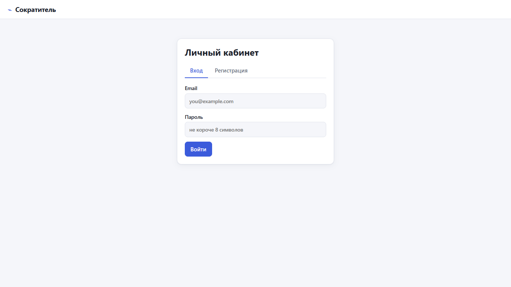
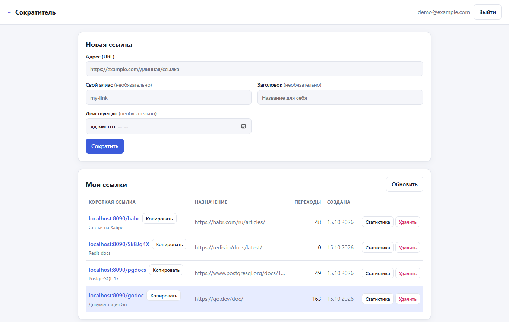
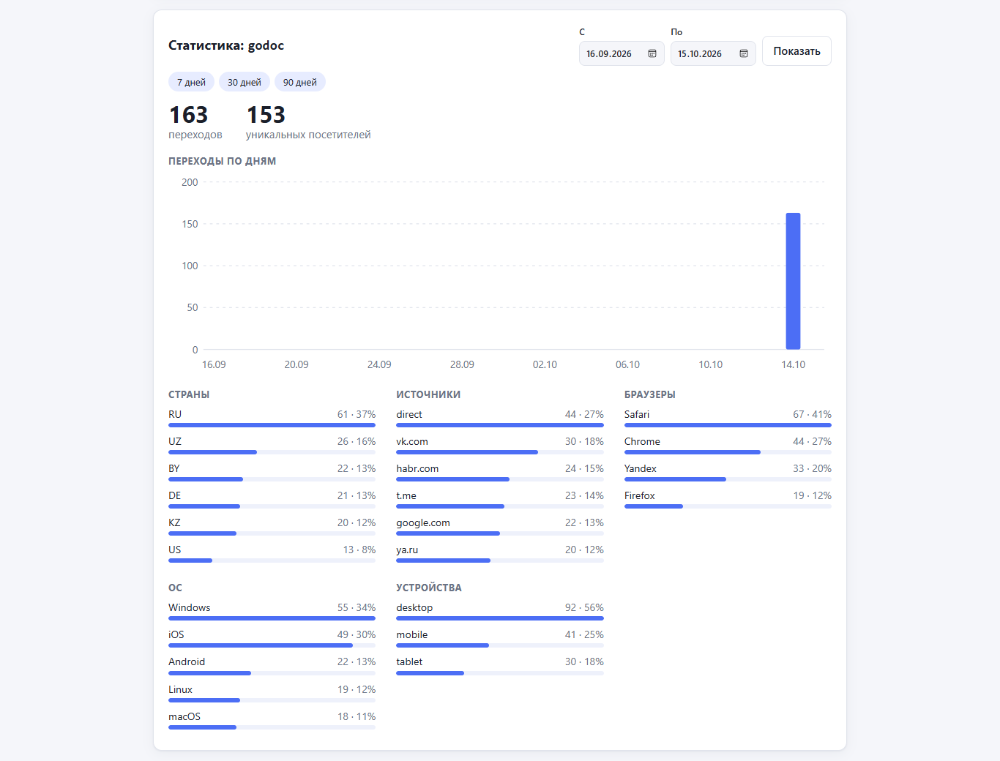
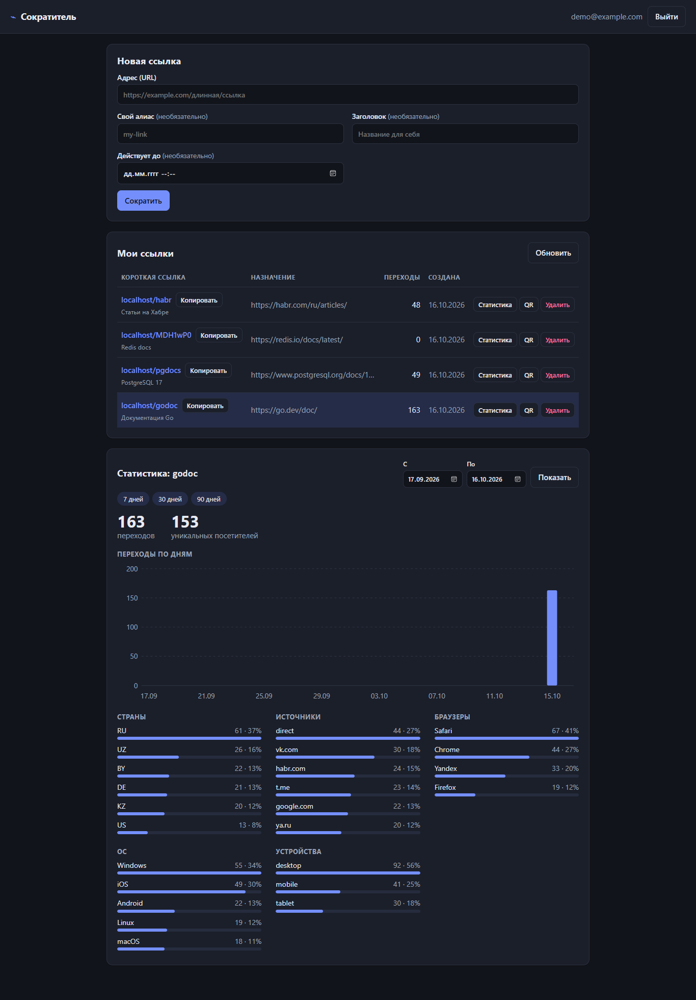
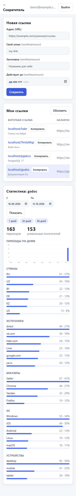

# Руководство пользователя

## 1 Назначение программы

«Сократитель ссылок» — веб-сервис, который превращает длинный адрес в короткий вида `http://localhost:8080/abc1234` и собирает статистику переходов по нему: количество переходов и уникальных посетителей, страны, источники (с каких сайтов пришли), браузеры, операционные системы и типы устройств. Работа с программой ведётся через браузер, в личном кабинете (дашборде).

## 2 Состав поставки

Папка с программой содержит следующие файлы:

| Файл | Назначение |
|---|---|
| `Запустить.bat` | запуск программы одним двойным щелчком; сам открывает дашборд в браузере |
| `shortener.exe` | сама программа (сервер); дашборд встроен внутрь, отдельные файлы не нужны |
| `Инструкция.docx`, `Инструкция.pdf` | настоящее руководство |

## 3 Системные требования

- Windows 10 или 11 (64-разрядная).
- Любой современный браузер: Chrome, Edge, Firefox, Яндекс Браузер, Opera.
- Свободный сетевой порт 8080.
- Установка не требуется: программа запускается прямо из папки, интернет не нужен.

## 4 Запуск и остановка

**Запуск.** Дважды щёлкните файл `Запустить.bat`. Откроется чёрное окно консоли с журналом работы сервера, а через 2 секунды в браузере откроется дашборд по адресу http://localhost:8080/dashboard/.

Если браузер не открылся сам, откройте этот адрес вручную.

**Важно:** не закрывайте окно консоли, пока работаете с программой. Закрытие окна останавливает сервер.

**Остановка.** Нажмите `Ctrl+C` в окне консоли или просто закройте его.

**Режим хранения данных.** При запуске из этой папки программа работает в демонстрационном режиме: ссылки, пользователи и статистика хранятся в оперативной памяти и **удаляются при остановке**. Для постоянного хранения используется полный режим с PostgreSQL и Redis (раздел 8).

## 5 Работа с программой

### 5.1 Регистрация и вход

При первом открытии дашборда отображается окно входа (рисунок 1).

Рисунок 1 — Окно входа и регистрации

1. Перейдите на вкладку «Регистрация».
2. Введите email (например, `test@example.com`) и пароль длиной не менее 8 символов.
3. Нажмите кнопку регистрации: вход выполнится автоматически.

При следующих запусках (пока сервер не перезапускался) используйте вкладку «Вход». Чтобы выйти, нажмите «Выйти» в правом верхнем углу.

### 5.2 Создание короткой ссылки

В блоке «Новая ссылка» (рисунок 2) заполните поля:

| Поле | Обязательное | Описание |
|---|---|---|
| Адрес (URL) | да | исходная ссылка; должна начинаться с `http://` или `https://` |
| Свой алиас | нет | желаемый короткий код, например `sale2026`: 3–32 символа, латинские буквы, цифры, `-` и `_`. Если поле пустое, код из 7 символов будет сгенерирован автоматически |
| Заголовок | нет | название для себя, отображается в списке ссылок |
| Действует до | нет | дата и время, после которых ссылка перестанет работать |

Нажмите «Сократить». Новая ссылка появится в таблице «Мои ссылки».

Возможные сообщения об ошибке (начало текста):
- «invalid url» — адрес указан неверно, не начинается с `http://`/`https://`, ведёт на сам сервис или срок действия указан в прошлом;
- «alias already taken» — такой алиас уже занят, выберите другой;
- «invalid alias» — алиас не соответствует правилам (после двоеточия указана причина).

Рисунок 2 — Создание ссылки и список «Мои ссылки»

### 5.3 Использование ссылки

Кнопка «Копировать» рядом с короткой ссылкой копирует её в буфер обмена. По короткой ссылке можно перейти в любом браузере: программа перенаправит посетителя на исходный адрес и учтёт переход. Чтобы проверить работу, откройте короткую ссылку несколько раз, в том числе из разных браузеров.

### 5.4 Просмотр статистики

Нажмите «Статистика» в строке нужной ссылки. Внизу страницы откроется панель статистики (рисунок 3):

- **итоги** — общее число переходов и число уникальных посетителей;
- **«Переходы по дням»** — столбчатый график;
- **«Страны», «Источники», «Браузеры», «ОС», «Устройства»** — рейтинги с количеством и долей переходов.

Период выбирается кнопками «7 дней», «30 дней», «90 дней» либо полями «С» и «По» с кнопкой «Показать». Кнопка «Обновить» над таблицей обновляет счётчики переходов.

Рисунок 3 — Панель статистики ссылки

Источник `direct` означает прямой переход (адрес введён вручную, открыт из мессенджера или закладок). Страна `ZZ` означает, что страну определить не удалось: в демонстрационном режиме это нормально, так как страна определяется по заголовку CDN или по базе GeoIP (раздел 8).

### 5.5 Удаление ссылки

Нажмите «Удалить» в строке ссылки и подтвердите действие. Ссылка исчезнет из списка, а переход по ней будет возвращать ошибку «ссылка недоступна» (код 410).

### 5.6 Оформление

Дашборд автоматически использует светлую или тёмную тему в соответствии с настройками Windows (рисунок 4). Он корректно отображается на экранах телефонов (рисунок 5).

Рисунок 4 — Тёмная тема

Рисунок 5 — Отображение на экране телефона

## 6 Служебные адреса

| Адрес | Назначение |
|---|---|
| http://localhost:8080/dashboard/ | дашборд |
| http://localhost:8080/healthz | проверка состояния: ответ `"status":"ok"` означает, что сервер работает |
| http://localhost:8080/metrics | счётчики работы в формате Prometheus: запросы, редиректы, события аналитики |

## 7 Возможные проблемы и их решение

| Проблема | Решение |
|---|---|
| Окно консоли сразу закрылось или в нём ошибка `bind: address already in use` / «Обычно разрешается только одно использование адреса» | Порт 8080 занят другой программой. Откройте `Запустить.bat` в Блокноте и замените `8080` на другой порт (например, `8081`) во всех строках, где он встречается |
| Браузер показывает «Не удаётся получить доступ к сайту» | Убедитесь, что окно консоли открыто и в нём нет ошибок; подождите несколько секунд и обновите страницу |
| После перезапуска пропали ссылки и учётная запись | Это поведение демонстрационного режима: данные хранятся в памяти. Зарегистрируйтесь заново |
| Windows SmartScreen предупреждает о неизвестном издателе | Программа не подписана цифровой подписью. Нажмите «Подробнее» → «Выполнить в любом случае» |
| Сообщение «too many requests» при входе или создании ссылок | Сработала защита от перебора (не более 5 запросов в секунду). Подождите несколько секунд |

## 8 Полный режим (PostgreSQL и Redis)

Для постоянного хранения данных программа запускается вместе с PostgreSQL и Redis через Docker. Требуются установленный Docker Desktop и исходный код проекта.

1. В папке проекта создайте файл `.env` со строкой `AUTH_SECRET=` и случайной строкой длиной не менее 32 символов.
2. Выполните команду `docker compose up --build`.
3. Откройте http://localhost:8080/dashboard/.

Для определения страны по IP-адресу можно указать путь к бесплатной базе MaxMind GeoLite2 в переменной окружения `GEOIP_DB`. Полный перечень настроек приведён в файле `README.md` проекта.

## 9 Запуск из исходного кода

При установленном Go 1.27 программу можно запустить из папки проекта командой `go run ./cmd/shortener`, а exe-файл собрать командой `go build -o shortener.exe ./cmd/shortener`. Тесты запускаются командой `go test ./...`.
