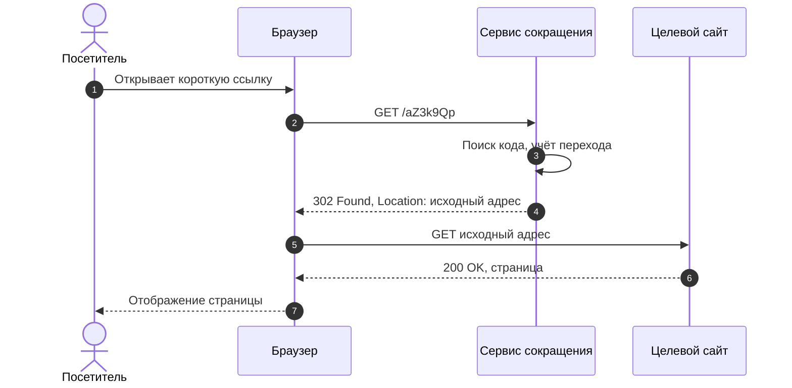

# 1 Аналитическая часть

## 1.1 Предметная область

### 1.1.1 Принцип работы сервиса сокращения ссылок

Сервис сокращения ссылок (URL shortener) устанавливает соответствие между коротким идентификатором (кодом) и исходным адресом ресурса. Пользователь передаёт сервису длинный адрес, получает короткий вида `https://example.com/aZ3k9Qp` и распространяет его. Когда посетитель открывает короткий адрес, браузер отправляет запрос на сервис, тот по коду находит исходный адрес и возвращает HTTP-ответ с перенаправлением; браузер автоматически переходит на целевую страницу. Принцип работы показан на рисунке 1.1.

Рисунок 1.1 — Принцип работы сервиса сокращения ссылок

Основными операциями являются создание ссылки (запись пары «код — адрес» в хранилище) и разрешение ссылки (поиск по коду). Соотношение этих операций в реальных системах сильно смещено в сторону чтения: каждая ссылка создаётся один раз, а открывается многократно, нередко тысячи и миллионы раз. Данное свойство определяет архитектуру: путь разрешения ссылки должен быть максимально быстрым и использовать кэширование, а побочные действия (запись статистики) не должны удлинять ответ [2].

### 1.1.2 Коды HTTP-перенаправлений

Семантика перенаправлений определена в спецификации RFC 9110 [8]. Для сокращателя значимы четыре кода класса 3xx, отличающиеся двумя свойствами: допускается ли кэширование перенаправления и сохраняется ли метод запроса (таблица 1.1).

Таблица 1.1 — Коды HTTP-перенаправлений

| Код | Название | Постоянство | Метод запроса | Замечания |
|---|---|---|---|---|
| 301 | Moved Permanently | Постоянное | Клиенты могут заменить POST на GET | Может кэшироваться по умолчанию; повторные переходы браузер может не отправлять на сервис |
| 302 | Found | Временное | Клиенты могут заменить POST на GET | Не кэшируется без явных заголовков; каждый переход проходит через сервис |
| 307 | Temporary Redirect | Временное | Метод сохраняется | Аналог 302 со строгой семантикой метода |
| 308 | Permanent Redirect | Постоянное | Метод сохраняется | Аналог 301 со строгой семантикой метода |

Постоянные перенаправления (301, 308) допускают кэширование ответа браузерами и промежуточными узлами. Если браузер запомнил такое перенаправление, при повторном обращении он перейдёт на целевой адрес без запроса к сервису, и этот переход не будет учтён. Кроме того, исправить или отключить ссылку после её кэширования клиентами невозможно. Поскольку основной функцией разрабатываемой системы является учёт каждого перехода, а также возможность деактивации ссылки и ограничения срока её жизни, выбрано временное перенаправление **302 Found**. Метод запроса для навигационных переходов браузера всегда GET, поэтому различие между 302 и 307 несущественно; выбор 302 обусловлен его распространённостью и совместимостью. Для исключения кэширования ответ дополнительно содержит заголовок `Cache-Control: private, max-age=0`. Недостатком временного перенаправления является несколько меньшая «передача ссылочного веса» поисковыми системами по сравнению с постоянным, однако для рассматриваемой задачи (маркетинг, рассылки, QR-коды) этот фактор не является определяющим.

### 1.1.3 Источники аналитики

При обработке перехода сервис получает от клиента набор данных, из которых формируется статистика.

1. **Заголовок Referer** содержит адрес страницы, с которой выполнен переход. По нему определяется источник трафика (социальная сеть, поисковая система, внешний сайт). Заголовок является необязательным: он отсутствует при переходе из мессенджера, почтового клиента, при вводе адреса вручную, а также может быть урезан политикой `Referrer-Policy` источника. Пустое значение трактуется как «прямой» переход (`direct`). Для агрегации хранится не полный адрес, а только домен, что уменьшает объём данных и риск сохранения персональной информации, содержащейся в параметрах запроса.
2. **Заголовок User-Agent** описывает клиентское приложение. Из него эвристическим путём извлекаются браузер, операционная система и тип устройства (настольный компьютер, мобильное устройство, планшет), а также выделяются запросы поисковых роботов и программ предварительного просмотра ссылок, которые не должны искажать статистику живых посетителей.
3. **IP-адрес** клиента используется для определения географии (страна) по базе данных соответствия сетей и территорий, например GeoLite2 [20]. Если сервис размещён за обратным прокси или CDN, реальный адрес берётся из доверенного заголовка `X-Forwarded-For`; доверять этому заголовку можно только при явно включённой настройке, иначе клиент сможет подделать адрес. Многие CDN дополнительно передают код страны готовым заголовком (например, `CF-IPCountry`), что позволяет обойтись без локальной базы. Разрабатываемый сервис учитывает этот заголовок так же, как `X-Forwarded-For`, — только при включённой настройке `TRUST_PROXY=true`; в противном случае страна определяется по локальной базе или принимает значение `ZZ` (неизвестно).
4. **Время запроса** используется для построения динамики переходов по дням.

### 1.1.4 Приватность и обезличивание

IP-адрес в совокупности с иными данными позволяет косвенно идентифицировать физическое лицо и в российском правовом поле может рассматриваться как персональные данные в смысле Федерального закона № 152-ФЗ [19]. Обработка таких данных предполагает наличие правового основания, определённых целей, уведомления субъекта и обязанности по защите. Для минимизации рисков при проектировании принят принцип минимизации данных:

- IP-адрес не сохраняется в базе данных и журналах приложения; он используется только в оперативной памяти для определения страны и вычисления идентификатора посетителя;
- идентификатор посетителя вычисляется как усечённый криптографический хэш SHA-256 от конкатенации секретной соли, IP-адреса и User-Agent и необратим при неизвестной соли; он позволяет подсчитывать уникальных посетителей, но не позволяет восстановить адрес;
- вместо полного Referer хранится только домен, вместо полного User-Agent — классифицированные значения браузера, ОС и устройства;
- гео-информация хранится с точностью до страны.

Следует отметить, что обезличивание уменьшает, но не исключает регуляторные риски полностью: окончательная юридическая квалификация зависит от условий эксплуатации и находится вне рамок настоящей работы.

## 1.2 Обзор аналогов

Для определения функциональных требований рассмотрены наиболее известные сервисы сокращения ссылок: коммерческие Bitly, TinyURL, Rebrandly, Short.io, бесплатный публичный сервис clck.ru (Яндекс) и два проекта с открытым исходным кодом — YOURLS и Kutt.

**Bitly** — один из первых и наиболее известных коммерческих сервисов; предоставляет сокращение ссылок, QR-коды, страницы «ссылка в профиле», собственные домены и расширенную аналитику (география, источники, устройства). Основные возможности настройки и глубина истории статистики зависят от тарифа. Имеет публичный API. Исходный код закрыт.

**TinyURL** — один из старейших публичных сервисов. Базовое сокращение доступно без регистрации; пользовательские алиасы, аналитика и собственные домены связаны с зарегистрированным аккаунтом и платными тарифами. Имеет API.

**Rebrandly** — сервис, ориентированный на брендированные ссылки с использованием собственного домена компании; предоставляет аналитику, группировку ссылок, API. Часть функций доступна на платных тарифах, существует ограниченный бесплатный тариф.

**Short.io** — коммерческий сервис с акцентом на собственные домены, аналитику, API и интеграции; имеется ограниченный бесплатный тариф.

**clck.ru** — публичный сервис компании «Яндекс». Отличается простотой: сокращение выполняется без развёртывания собственной инфраструктуры и без сложной настройки; возможности управления ссылкой (алиасы, срок жизни, личный кабинет с аналитикой) ограничены по сравнению с коммерческими платформами. Предоставляет простой программный интерфейс. Исходный код закрыт.

**YOURLS** (Your Own URL Shortener) — свободное решение на PHP, разворачиваемое на собственном сервере. Поддерживает пользовательские ключевые слова, базовую статистику переходов, API и расширение плагинами (в частности, для гео-определения, ограничения срока жизни и т. п.). Требует web-сервера и MySQL-совместимой СУБД; архитектура ориентирована на классические хостинги, высокая нагрузка требует дополнительной настройки кэширования.

**Kutt** — свободное решение на Node.js для самостоятельного размещения. Поддерживает собственные домены, пользовательские алиасы, защиту ссылки паролем, срок жизни, статистику и API.

Результаты сравнения приведены в таблице 1.2. Оценки носят обобщённый характер: наборы функций и условия тарифов у коммерческих сервисов меняются, поэтому точные ограничения не приводятся и должны уточняться на сайтах сервисов.

Таблица 1.2 — Сравнение сервисов сокращения ссылок

| Критерий | Bitly | TinyURL | Rebrandly | Short.io | clck.ru | YOURLS | Kutt | Разрабатываемый сервис |
|---|---|---|---|---|---|---|---|---|
| Собственный алиас | да (в т. ч. на платных тарифах) | да (с аккаунтом) | да | да | ограниченно | да | да | да |
| Срок жизни ссылки | на платных тарифах | на платных тарифах | да | да | нет данных / не основная функция | через плагин | да | да |
| Аналитика: география | да | на платных тарифах | да | да | ограниченно | базово / плагины | да | да (страна) |
| Аналитика: рефереры | да | на платных тарифах | да | да | ограниченно | да | да | да (домен) |
| Аналитика: устройства | да | на платных тарифах | да | да | ограниченно | базово | да | да (браузер, ОС, тип) |
| API | да | да | да | да | простой публичный | да | да | да (REST, JSON) |
| Открытый код, self-hosted | нет | нет | нет | нет | нет | да | да | да |
| Бесплатный тариф | да, ограниченный | да, ограниченный | да, ограниченный | да, ограниченный | бесплатный сервис | бесплатное ПО | бесплатное ПО | бесплатное ПО |
| Основные ограничения | лимиты и функции зависят от тарифа | детальная аналитика платная | лимиты бесплатного тарифа | лимиты бесплатного тарифа | минимум функций, данные у третьей стороны | PHP-стек, масштабирование вручную | Node.js-стек, свой набор зависимостей | учебный проект: нет собственных доменов, проверки на фишинг |

Анализ показывает, что коммерческие сервисы обладают наиболее полным набором функций, но предполагают хранение статистики и ссылок у третьей стороны, зависят от тарифной политики и закрыты для модификации. Открытые решения YOURLS и Kutt закрывают потребность в самостоятельном размещении, но используют иные технологические стеки и не ориентированы на конкретную связку Go, PostgreSQL и Redis. Разрабатываемый сервис ориентирован на минимально достаточный набор функций (алиасы, срок жизни, QR-коды, аналитика по странам, источникам и устройствам, REST API, дашборд) при приоритете производительности редиректа и приватности данных посетителей.

## 1.3 Способы генерации коротких кодов

### 1.3.1 Сравнение подходов

Код ссылки должен быть коротким, уникальным и, желательно, непредсказуемым. Рассмотрены три подхода (таблица 1.3).

Таблица 1.3 — Способы генерации коротких кодов

| Способ | Принцип | Достоинства | Недостатки |
|---|---|---|---|
| Счётчик + base62 | Порядковый номер записи кодируется в системе счисления по основанию 62 | Нет коллизий по построению; коды самые короткие | Коды предсказуемы, возможен перебор всех ссылок подряд; требуется глобальный счётчик — узкое место и точка отказа при масштабировании |
| Хэш URL | Берётся усечённый префикс хэша (MD5, SHA-256) от исходного адреса и кодируется в base62 | Одинаковый адрес даёт одинаковый код; не нужен счётчик | Коллизии при усечении, требующие обработки; один код на адрес мешает отдельному учёту для разных владельцев и кампаний; при добавлении «соли» для устранения этого недостатка преимущество теряется |
| Случайный код | Код формируется из криптографически стойкого генератора псевдослучайных чисел | Непредсказуемость; независимость узлов (нет общего счётчика); простая реализация | Возможны коллизии, поэтому требуются проверка уникальности и повтор |

Для сервиса с аналитикой, где каждый владелец должен иметь собственную ссылку на один и тот же адрес (разные кампании — разная статистика), хэширование адреса неприменимо. Счётчик создаёт предсказуемость: злоумышленник может перебрать пространство и получить доступ к «скрытым» ссылкам, не предназначенным для публичного распространения. Поэтому выбран **случайный код** фиксированной длины (по умолчанию 7 символов алфавита `0-9A-Za-z`), формируемый генератором `crypto/rand` с отсечением (rejection sampling) значений, исключающим смещение распределения. Уникальность гарантируется ограничением `UNIQUE` в базе данных; при нарушении выполняется повторная генерация (не более пяти попыток).

### 1.3.2 Ёмкость пространства кодов

Алфавит base62 содержит 62 символа (10 цифр, 26 строчных и 26 прописных латинских букв). Число различных кодов длиной *L* равно 62^*L*. Значения для разных длин приведены в таблице 1.4.

Таблица 1.4 — Ёмкость пространства кодов

| Длина кода L | Число кодов 62^L | Порядок величины |
|---|---|---|
| 5 | 916 132 832 | 9,2·10^8 |
| 6 | 56 800 235 584 | 5,7·10^10 |
| 7 | 3 521 614 606 208 | 3,5·10^12 |
| 8 | 218 340 105 584 896 | 2,2·10^14 |

При *L* = 7 доступно *N* = 62^7 ≈ 3,52·10^12 кодов, что многократно превышает потребности даже крупных сервисов.

### 1.3.3 Вероятность коллизий

Вероятность того, что среди *n* независимо случайно выбранных кодов из *N* возможных найдётся хотя бы одна пара совпадающих, описывается задачей о днях рождения (парадоксом дней рождения) [2]:

P(*n*) = 1 − ∏*k*=0*n*−1 (1 − *k*/*N*) ≈ 1 − exp(−*n*(*n*−1) / (2*N*)).

Для *n* = 10^7 и *N* = 3,52·10^12 показатель экспоненты равен

*n*(*n*−1)/(2*N*) ≈ 10^14 / (2 · 3,52·10^12) ≈ 14,2,

откуда P ≈ 1 − e^(−14,2) ≈ 1 − 6,8·10^(−7) ≈ 0,9999993. Иными словами, среди десяти миллионов случайных 7-символьных кодов совпадение хотя бы одной пары практически неизбежно, а математическое ожидание числа совпадающих пар равно примерно 14. Это не означает проблемы для системы: коллизия возникает только тогда, когда сгенерированный код **уже занят**, и она обнаруживается при вставке благодаря ограничению уникальности. Практический интерес представляет вероятность коллизии при вставке очередной записи в таблицу, содержащую *k* кодов: p = *k*/*N*. Для *k* = 10^7 имеем p ≈ 10^7 / 3,52·10^12 ≈ 2,8·10^(−6), то есть примерно один случай на 350 тысяч создаваемых ссылок. Вероятность того, что все пять последовательных попыток окажутся неудачными, составляет p^5 ≈ 1,8·10^(−28) и пренебрежимо мала. Суммарное ожидаемое число повторных генераций при создании 10^7 ссылок равно сумме *k*/*N* по *k* от 0 до *n*−1, то есть ≈ *n*²/(2*N*) ≈ 14. Таким образом, при длине 7 накладные расходы на обработку коллизий ничтожны (около 14 дополнительных обращений на 10^7 вставок).

Если бы уникальность не проверялась (например, при хэшировании без контроля), вероятность ошибки была бы неприемлемой уже при существенно меньшем числе записей: значение *n*, при котором P = 0,5, составляет приблизительно 1,18·√*N* ≈ 2,2·10^6 ссылок. Это обосновывает обязательность проверки уникальности на уровне СУБД, а не на уровне приложения.

Непредсказуемость кодов оценивается вероятностью угадывания существующей ссылки одной попыткой: при 10^7 активных ссылок она составляет около 2,8·10^(−6). Для перебора, существенно затрагивающего пространство, требуются миллиарды запросов, что делает перебор экономически бессмысленным и легко обнаруживаемым при мониторинге.

### 1.3.4 Пользовательские алиасы

Помимо случайных кодов, владелец ссылки может задать собственный алиас (3–32 символа `A-Za-z0-9_-`, не начинающийся с `-` или `_`). Алиас проверяется на допустимые символы и на отсутствие в списке зарезервированных путей (`api`, `dashboard`, `static`, `healthz`, `metrics`, `login`, `register`, `admin`, `favicon.ico`, `robots.txt`), чтобы он не перекрывал служебные адреса сервиса. Занятость алиаса определяется тем же ограничением уникальности; при конфликте возвращается ошибка `409 Conflict`.

## 1.4 Требования к системе

### 1.4.1 Функциональные требования

**ФТ-1. Регистрация и аутентификация.** Система должна позволять пользователю зарегистрироваться по адресу электронной почты и паролю (от 8 до 72 байт — предел алгоритма bcrypt) и войти в систему, получив токен доступа ограниченного срока действия.

**ФТ-2. Создание короткой ссылки.** Аутентифицированный пользователь должен иметь возможность создать короткую ссылку для адреса с протоколом `http` или `https`, указав при необходимости название, пользовательский алиас и срок действия.

**ФТ-3. Валидация адреса.** Система должна отклонять пустые, чрезмерно длинные (более 2048 символов), синтаксически некорректные адреса, адреса с иными схемами (`javascript:`, `data:`, `file:` и др.), а также адреса, ведущие на сам сервис.

**ФТ-4. Перенаправление.** Любой посетитель должен при открытии короткого адреса `/{code}` быть перенаправлен на исходный адрес ответом `302 Found`; для несуществующего кода возвращается `404`, для истёкшей или отключённой ссылки — `410 Gone`.

**ФТ-5. Срок жизни и деактивация.** Система должна прекращать перенаправление по истечении срока действия ссылки и позволять владельцу отключить ссылку.

**ФТ-6. Управление ссылками.** Владелец должен получать список своих ссылок (с постраничной выдачей), просматривать отдельную ссылку и удалять (деактивировать) её. Доступ к чужим ссылкам запрещён.

**ФТ-7. Сбор статистики.** Система должна регистрировать каждый переход с указанием времени, реферера (домена), страны, браузера, ОС и типа устройства и вычислять обезличенный идентификатор посетителя.

**ФТ-8. Выдача статистики.** Владелец должен получать агрегированную статистику по ссылке за выбранный период (по умолчанию 30 дней, максимум 366 дней): общее число переходов, число уникальных посетителей, распределение по дням, странам, источникам, браузерам, ОС и типам устройств.

**ФТ-9. Дашборд.** Система должна предоставлять веб-интерфейс, в котором владелец создаёт ссылки, видит их список и графики статистики.

**ФТ-10. Популярные ссылки.** Система должна публично выдавать список наиболее популярных кодов.

**ФТ-11. Служебные функции.** Система должна предоставлять проверку состояния (`/healthz`) и метрики для мониторинга (`/metrics`).

**ФТ-12. QR-код ссылки.** Система должна выдавать QR-код короткой ссылки в виде PNG-изображения запрошенного размера (от 64 до 1024 пикселей, по умолчанию 256) по адресу `/qr/{code}.png`; для несуществующего кода возвращается `404`, для отключённой или истёкшей ссылки — `410 Gone`, для недопустимого размера — `400`. Выдача QR-кода не считается переходом и не учитывается в статистике; дашборд предоставляет просмотр и скачивание кода.

### 1.4.2 Нефункциональные требования

**НФТ-1. Производительность редиректа.** Разрешение популярной ссылки должно выполняться без обращения к основной СУБД (через кэш); задержка обработки на стороне сервиса при попадании в кэш должна измеряться единицами миллисекунд. Запись статистики не должна выполняться в критическом пути запроса. Производительность проверяется микробенчмарками и нагрузочным тестом редиректа (генератор `cmd/loadgen`; подготовлен также сценарий k6).

**НФТ-2. Доступность при отказе кэша.** Недоступность Redis не должна приводить к отказу редиректов: сервис обязан деградировать до чтения из PostgreSQL, фиксируя предупреждения в журнале.

**НФТ-3. Устойчивость к перегрузке аналитики.** При переполнении очереди событий сервис должен отбрасывать события с учётом счётчика потерь, но не блокировать обработку переходов.

**НФТ-4. Надёжность данных.** Данные ссылок, пользователей и переходов хранятся в реляционной СУБД с транзакционными гарантиями; схема изменяется только через версионируемые миграции. При остановке сервиса необработанные события аналитики должны быть сброшены в хранилище (graceful shutdown).

**НФТ-5. Безопасность.** Требования рассмотрены в разделе 1.4.3.

**НФТ-6. Масштабируемость.** Приложение не должно хранить пользовательское состояние в памяти процесса (токены самодостаточны, кэш — во внешнем Redis), чтобы допускалось горизонтальное масштабирование за балансировщиком.

**НФТ-7. Конфигурируемость и переносимость.** Все параметры задаются переменными окружения; система запускается одной командой Docker Compose; без внешних сервисов возможен запуск в демонстрационном режиме с хранилищем в памяти.

**НФТ-8. Качество кода.** Все пакеты покрываются модульными тестами; в конвейере непрерывной интеграции выполняются статический анализ, проверка уязвимостей и сборка образа.

### 1.4.3 Требования безопасности

Анализ выполнен по классификации OWASP Top 10 [17]. Применимость и меры приведены в таблице 1.5.

Таблица 1.5 — Угрозы безопасности и меры защиты

| Угроза | Применимость | Мера защиты |
|---|---|---|
| Открытое перенаправление (Unvalidated Redirects) [18] | Сервис по определению выполняет перенаправление на адрес, заданный пользователем, и может использоваться для маскировки вредоносных адресов | Допускаются только схемы `http`/`https`; запрещены ссылки на сам сервис (исключаются цепочки редиректов); возможность деактивации ссылки; регистрация владельца каждой ссылки; ограничение частоты создания |
| SSRF (Server-Side Request Forgery) | Не применима: сервис не выполняет запросов по пользовательским адресам, не загружает страницы и не получает превью | Архитектурное решение: адрес только сохраняется и возвращается клиенту в заголовке `Location` |
| Нарушение контроля доступа (Broken Access Control) | Применима: владелец не должен видеть и менять чужие ссылки и статистику | Все операции выполняются с проверкой `owner_id`; чужая ссылка неотличима от отсутствующей (`404`) |
| Подбор паролей | Применима к `/auth/login` | Rate limiting по IP на регистрацию и вход (`/auth/register`, `/auth/login`); хэширование bcrypt с параметром стоимости 12; единое сообщение об ошибке для неверного email и неверного пароля; при неизвестном email выполняется сравнение с фиктивным хэшем, чтобы время ответа не выдавало существование учётной записи |
| Хранение паролей, криптографические сбои | Применимо | Пароли хранятся только в виде bcrypt-хэшей; токены подписываются HMAC-SHA256 с секретом из окружения; при использовании PostgreSQL секрет обязателен |
| Внедрение (SQL-инъекции) | Применимо | Параметризованные запросы драйвера pgx; отсутствие конкатенации SQL |
| XSS в дашборде | Применима: в интерфейсе выводятся названия и адреса, введённые пользователями | Весь пользовательский текст выводится средствами DOM (`textContent`, `createElement`); `innerHTML` не применяется; заголовки безопасности (`Content-Security-Policy` с `script-src 'self'`, `X-Content-Type-Options`, `X-Frame-Options`, `Referrer-Policy`) |
| Отказ в обслуживании | Применим | Rate limiting на создание ссылок, регистрацию и вход (token bucket по IP; по умолчанию 5 запросов/с, всплеск 20); ограничение размера тела запроса 64 КБ; ограниченная очередь аналитики; для лимитирования самого редиректа на уровне сети предполагается обратный прокси |
| Подделка IP через `X-Forwarded-For` | Применима к аналитике и rate limiting | Заголовки `X-Forwarded-For` и `CF-IPCountry` учитываются только при `TRUST_PROXY=true` |
| Уязвимые зависимости | Применима | `govulncheck`, `gosec`, Dependabot в конвейере CI |
| Раскрытие персональных данных | Применимо | Обезличивание: IP не хранится (см. 1.1.4) |

Следует отметить, что выбранные меры не обеспечивают защиту от размещения ссылок на фишинговые ресурсы; для промышленной эксплуатации необходимо интегрировать проверку адресов по базам вредоносных ресурсов, что выходит за пределы настоящей работы.

## 1.5 Выводы по главе 1

1. Проанализирован принцип работы сервиса сокращения ссылок. Показано, что для учёта каждого перехода и возможности отключения ссылки следует применять временное перенаправление 302 с запретом кэширования ответа клиентом.
2. Определены источники аналитики (Referer, User-Agent, IP-адрес, время) и принципы обезличивания: IP-адрес не сохраняется, уникальные посетители определяются по солёному хэшу, реферер сводится к домену.
3. Выполнен обзор семи аналогов; установлено, что коммерческие сервисы функциональны, но закрыты и хранят данные у третьей стороны, а открытые решения используют иные стеки; обоснована целесообразность собственной реализации на Go, PostgreSQL и Redis.
4. Для генерации кодов выбран случайный base62-код длиной 7 символов (ёмкость ≈ 3,5·10^12); показано, что вероятность коллизии при вставке в таблицу из 10^7 записей составляет около 2,8·10^(−6), что решается ограничением уникальности и повторной генерацией.
5. Сформулированы 12 функциональных и 8 нефункциональных требований, проведён анализ угроз по OWASP; эти требования являются исходными данными для проектирования во второй главе.
