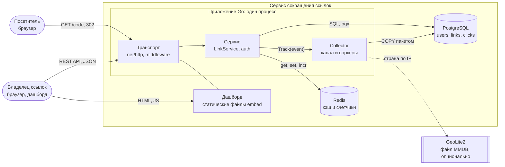
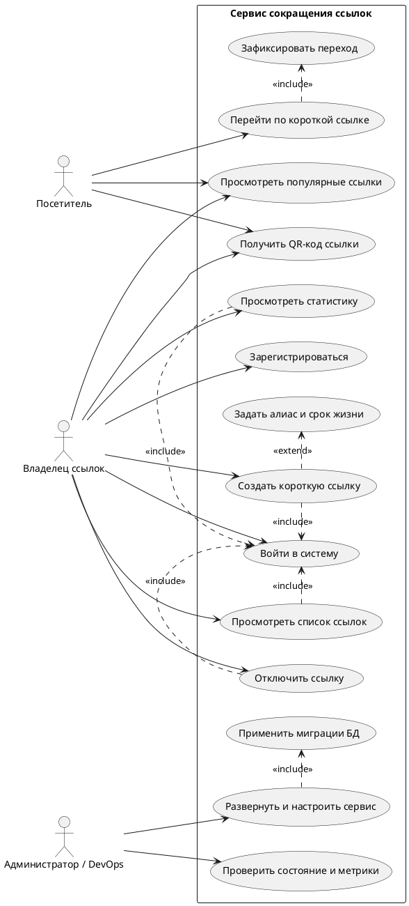
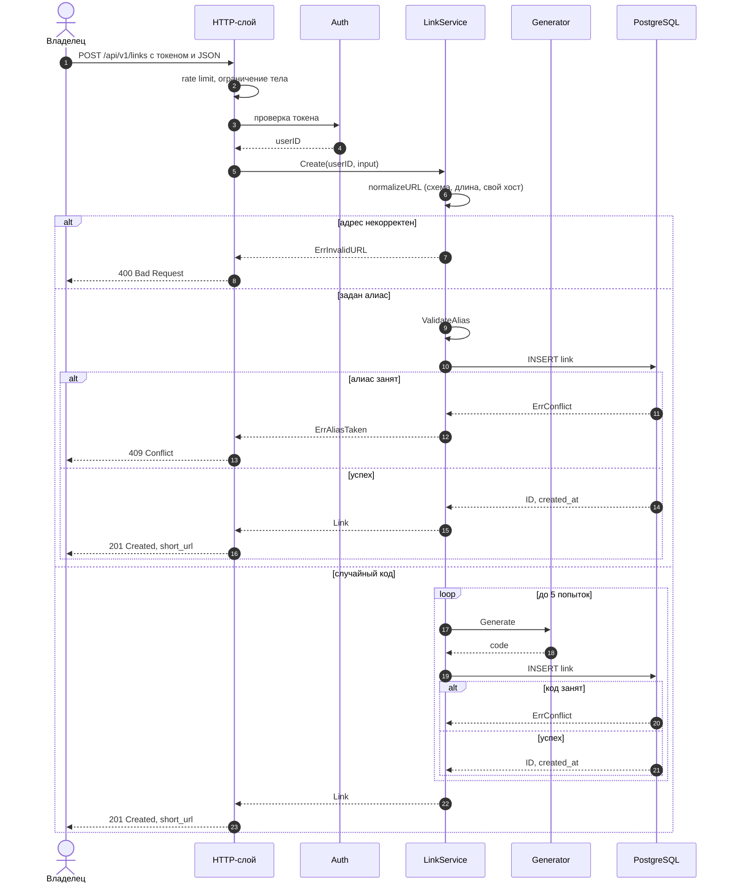
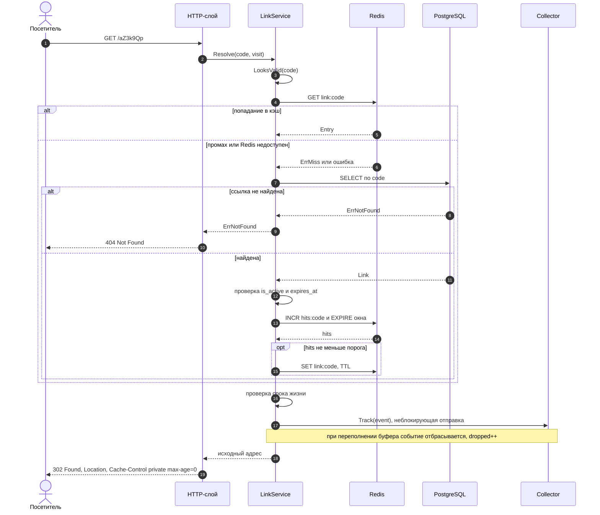
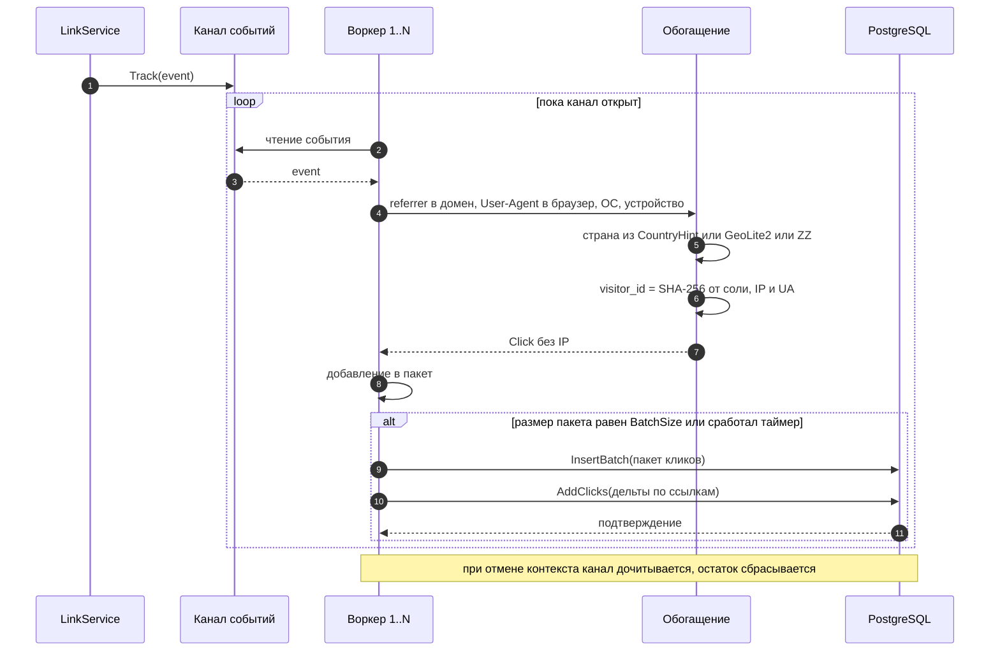
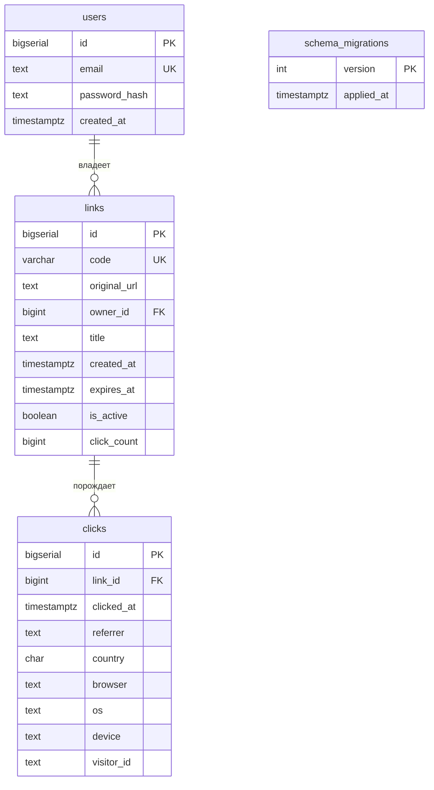
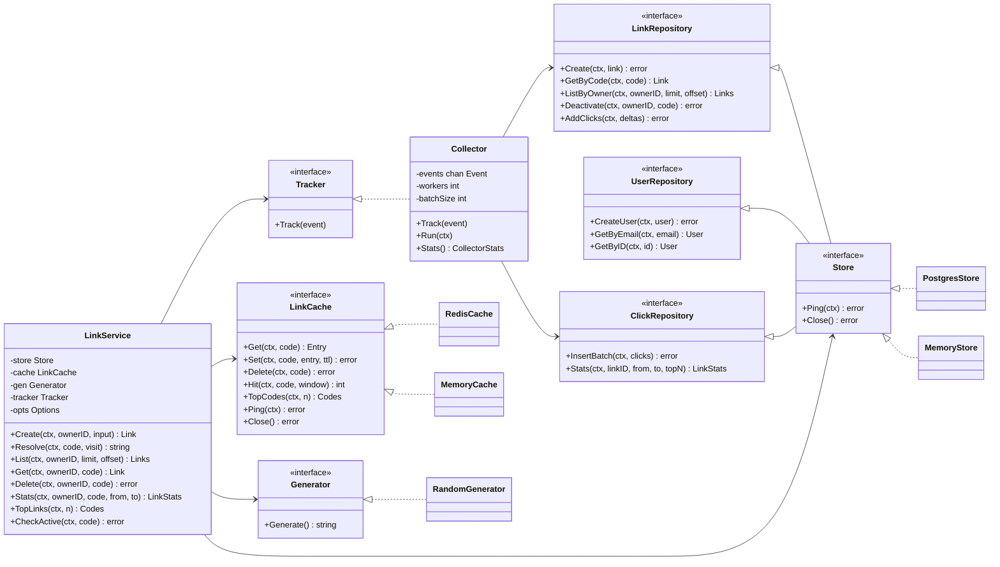
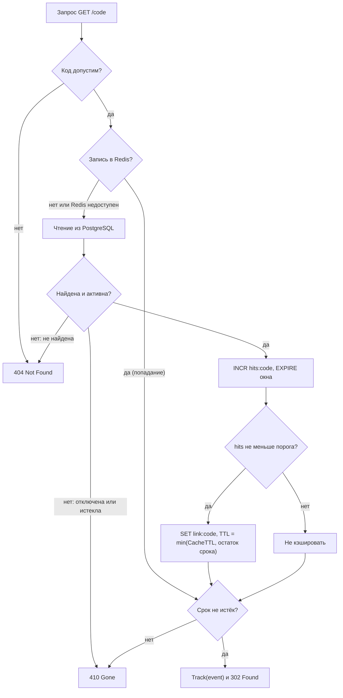
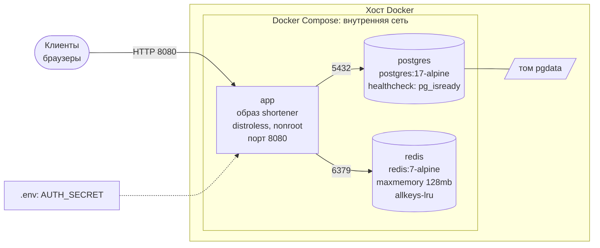

# 2 Проектная часть

## 2.1 Архитектура системы

Система построена по слоистой архитектуре с однонаправленными зависимостями [4, 6]: транспортный слой (HTTP) обращается к слою бизнес-логики (сервису), а тот — к абстракциям хранилища, кэша и сборщика аналитики. Слои взаимодействуют через интерфейсы, определённые в потребляющих пакетах, поэтому конкретные реализации (PostgreSQL, Redis или реализации в памяти для тестов) подменяются без изменения бизнес-логики. Структура пакетов приведена в таблице 2.1.

Таблица 2.1 — Пакеты системы

| Слой | Пакет | Назначение |
|---|---|---|
| Транспорт | `internal/httpapi` | HTTP-обработчики, middleware (request-id, recover, access-log, ограничение тела, rate limiting, заголовки безопасности), раздача дашборда |
| Бизнес-логика | `internal/service` | `LinkService`: создание, разрешение, удаление, статистика |
| Бизнес-логика | `internal/auth` | регистрация, вход, bcrypt, HMAC-токены |
| Бизнес-логика | `internal/qrcode` | формирование PNG с QR-кодом короткой ссылки (кодирование матрицы — `rsc.io/qr`, отрисовка в 1-битный PNG — собственная) |
| Бизнес-логика | `internal/shortcode` | генерация кодов base62, валидация алиасов |
| Данные | `internal/storage`, `storage/postgres`, `storage/memory` | интерфейсы хранилища и реализации |
| Данные | `internal/cache` (`RedisCache`, `MemoryCache`) | кэш горячих ссылок и счётчики популярности |
| Аналитика | `internal/analytics` | `Collector`: очередь, воркеры, обогащение, пакетная запись; парсинг User-Agent, Referer, гео |
| Модель | `internal/model` | доменные сущности |
| Инфраструктура | `internal/config`, `cmd/shortener` | конфигурация из окружения, сборка зависимостей, graceful shutdown |
| Представление | `web/` | дашборд (HTML и JavaScript, встраивается в бинарный файл через `embed`) |

Ключевая особенность — **асинхронный конвейер аналитики**: обработчик редиректа не ждёт записи статистики, а помещает событие в буферизованный канал, из которого воркеры пакетно записывают данные в PostgreSQL. Благодаря этому задержка редиректа не зависит от скорости записи в базу.

На рисунке 2.1 показана диаграмма контейнеров (C4, уровень Container).

Рисунок 2.1 — Диаграмма контейнеров системы (C4, уровень Container)

## 2.2 Диаграмма вариантов использования

Выделены три роли: **Посетитель** (любой, кто открывает короткую ссылку), **Владелец ссылок** (зарегистрированный пользователь дашборда) и **Администратор / DevOps** (развёртывание и сопровождение). Вариант использования «Получить QR-код ссылки» (UC14) доступен без входа в систему, так как QR-код содержит только саму короткую ссылку, которая и так публична; на практике им пользуется владелец ссылки из дашборда. Диаграмма вариантов использования показана на рисунке 2.2.

Рисунок 2.2 — Диаграмма вариантов использования

## 2.3 Диаграммы последовательности

### 2.3.1 Создание ссылки

Запрос создания ссылки (`POST /api/v1/links`) проходит цепочку middleware (rate limiting, ограничение тела), проверку токена, нормализацию адреса и генерацию кода. При использовании случайного кода уникальность проверяется ограничением БД, а при конфликте выполняется повторная попытка (рисунок 2.3).

Рисунок 2.3 — Последовательность создания короткой ссылки

### 2.3.2 Редирект с кэшем и постановкой события в очередь

Основной сценарий системы — разрешение ссылки (рисунок 2.4). Сначала выполняется поиск в Redis. При попадании запрос к БД не требуется. При промахе (или недоступности Redis) ссылка читается из PostgreSQL, увеличивается счётчик обращений в окне, и при достижении порога популярности ссылка помещается в кэш. В любом случае событие перехода неблокирующим образом ставится в очередь аналитики.

Рисунок 2.4 — Последовательность редиректа с кэшированием и постановкой события в очередь

### 2.3.3 Сбор аналитики

Сбор статистики вынесен в фоновый конвейер (рисунок 2.5). N воркеров читают события из общего канала, обогащают их и накапливают пакет. Пакет записывается при достижении размера `ANALYTICS_BATCH` либо по таймеру `ANALYTICS_FLUSH`. При остановке приложения канал дочитывается, и накопленные данные сбрасываются.

Рисунок 2.5 — Последовательность сбора и пакетной записи аналитики

## 2.4 Модель данных

Данные хранятся в PostgreSQL в четырёх таблицах (рисунок 2.6): `users`, `links`, `clicks` и служебной `schema_migrations`, в которой фиксируются применённые миграции. Таблицы `users`, `links` и `clicks` создаёт SQL-файл `001_init.sql`, а `schema_migrations` — код применения миграций (`Migrate`) перед выполнением файлов, поэтому её описания в SQL-миграции нет.

Рисунок 2.6 — ER-диаграмма базы данных

Описание таблиц приведено в таблице 2.2.

Таблица 2.2 — Структура таблиц базы данных

| Таблица | Поле | Тип | Ограничения / назначение |
|---|---|---|---|
| `users` | `id` | BIGSERIAL | первичный ключ |
| | `email` | TEXT | NOT NULL, UNIQUE; идентификатор для входа |
| | `password_hash` | TEXT | NOT NULL; bcrypt-хэш |
| | `created_at` | TIMESTAMPTZ | NOT NULL, по умолчанию `now()` |
| `links` | `id` | BIGSERIAL | первичный ключ |
| | `code` | VARCHAR(32) | NOT NULL, UNIQUE; короткий код или алиас |
| | `original_url` | TEXT | NOT NULL; адрес назначения |
| | `owner_id` | BIGINT | внешний ключ на `users(id)`, `ON DELETE CASCADE` |
| | `title` | TEXT | NOT NULL, по умолчанию пустая строка |
| | `created_at` | TIMESTAMPTZ | NOT NULL, по умолчанию `now()` |
| | `expires_at` | TIMESTAMPTZ | NULL — бессрочная ссылка |
| | `is_active` | BOOLEAN | NOT NULL, по умолчанию `true`; признак «мягкого» удаления |
| | `click_count` | BIGINT | NOT NULL, по умолчанию 0; денормализованный счётчик |
| `clicks` | `id` | BIGSERIAL | первичный ключ |
| | `link_id` | BIGINT | NOT NULL, внешний ключ на `links(id)`, `ON DELETE CASCADE` |
| | `clicked_at` | TIMESTAMPTZ | NOT NULL; время перехода |
| | `referrer` | TEXT | домен источника или `direct` |
| | `country` | CHAR(2) | код ISO 3166-1 alpha-2 или `ZZ` |
| | `browser`, `os`, `device` | TEXT | классифицированные значения User-Agent |
| | `visitor_id` | TEXT | обезличенный хэш для подсчёта уникальных посетителей |
| `schema_migrations` | `version` | INT | первичный ключ; номер применённой миграции |
| | `applied_at` | TIMESTAMPTZ | время применения |

**Индексы и их обоснование.**

- `links.code` — уникальный индекс, создаваемый ограничением `UNIQUE`. Обслуживает самую частую операцию (поиск по коду при редиректе) и одновременно гарантирует уникальность кодов, необходимую для обработки коллизий (раздел 1.3.3).
- `idx_links_owner_created (owner_id, created_at DESC)` — составной индекс для выдачи списка ссылок владельца в порядке «новые первыми» без отдельной сортировки.
- `idx_clicks_link_time (link_id, clicked_at)` — основной индекс аналитических запросов: статистика всегда считается по одной ссылке за временной интервал, поэтому условие `link_id = ? AND clicked_at >= ? AND clicked_at < ?` выполняется диапазонным сканированием индекса.
- `users.email` — уникальный индекс для входа по email и контроля уникальности.

**Денормализация `click_count`.** Счётчик переходов хранится в таблице `links` для быстрого отображения в списке без агрегирования миллионов строк `clicks`. Он увеличивается агрегированными дельтами: после вставки пакета выполняется один запрос `UPDATE ... FROM unnest(...)`, поэтому число обновлений строк `links` пропорционально числу пакетов и числу затронутых ссылок, а не числу переходов. Вставка пакета и обновление счётчиков выполняются отдельными запросами без общей транзакции; при сбое второго запроса ошибка фиксируется в журнале, а значение `click_count` может отставать от числа строк `clicks`.

**Каскадное удаление.** Удаление пользователя удаляет его ссылки, а удаление ссылки — её переходы, что исключает «осиротевшие» записи. Операция удаления в API реализована как деактивация (`is_active = false`), история статистики при этом сохраняется.

**Типы данных.** Время хранится с часовым поясом (`TIMESTAMPTZ`), что исключает ошибки при сравнении моментов. Страна хранится как `CHAR(2)` с кодом `ZZ` для неизвестного значения. Идентификатор посетителя представлен хэшем, а не IP-адресом, что соответствует принципу минимизации данных (раздел 1.1.4).

Масштабирование таблицы `clicks`, растущей быстрее остальных, возможно секционированием по времени (`PARTITION BY RANGE (clicked_at)`) и/или предварительной агрегацией по дням; в текущей версии эти меры не реализованы и рассматриваются как направление развития.

## 2.5 Проектирование REST API

Программный интерфейс построен по принципам REST поверх HTTP с обменом в формате JSON. Версия API включена в путь (`/api/v1`). Аутентификация — токен в заголовке `Authorization: Bearer <token>`. Перечень конечных точек приведён в таблице 2.3.

Таблица 2.3 — Конечные точки REST API

| Метод | Путь | Описание | Аутентификация | Успешный ответ | Коды ошибок |
|---|---|---|---|---|---|
| POST | `/api/v1/auth/register` | Регистрация: `{email, password}` | нет | `201 {token, user}` | 400, 409, 413, 429 |
| POST | `/api/v1/auth/login` | Вход: `{email, password}` | нет | `200 {token, user}` | 400, 401, 429 |
| GET | `/api/v1/me` | Идентификатор текущего пользователя | да | `200 {id}` | 401 |
| POST | `/api/v1/links` | Создание ссылки (`url`, `alias`, `title`, `expires_at`) | да | `201 link + short_url`, заголовок `Location` | 400, 401, 409, 413, 429 |
| GET | `/api/v1/links?limit&offset` | Список ссылок владельца | да | `200 {links: [link]}` | 400, 401 |
| GET | `/api/v1/links/{code}` | Одна ссылка | да | `200 link` | 401, 404 |
| DELETE | `/api/v1/links/{code}` | Деактивация ссылки | да | `204` | 401, 404 |
| GET | `/api/v1/links/{code}/stats?from&to` | Статистика за период (по умолчанию 30 дней; `to` включительно) | да | `200 LinkStats` | 400, 401, 404 |
| GET | `/api/v1/top?n=10` | Популярные коды | нет | `200 {codes: [code]}` | 400 |
| GET | `/qr/{code}.png?size=N` | QR-код короткой ссылки (`size` 64–1024, по умолчанию 256) | нет | `200 image/png`, `Cache-Control: public, max-age=3600` | 400, 404, 410 |
| GET | `/{code}` | Редирект | нет | `302 Location` | 404, 410 |
| GET | `/healthz` | Проверка БД и кэша: `{status, checks}` | нет | `200` | 503 |
| GET | `/metrics` | Метрики в текстовом формате Prometheus | нет | `200` | — |
| GET | `/dashboard/` | Дашборд | нет | `200 HTML` | — |
| GET | `/` | Перенаправление на дашборд | нет | `302` | — |

Ошибки возвращаются в едином формате `{"error": "описание"}`. Соответствие внутренних ошибок сервиса кодам ответа приведено в таблице 2.4.

Таблица 2.4 — Соответствие ошибок и кодов HTTP

| Ошибка сервиса | Код HTTP | Смысл |
|---|---|---|
| `ErrInvalidURL`, `ErrBadAlias`, `ErrBadPeriod`, параметр `size` вне диапазона 64–1024 | 400 Bad Request | некорректные входные данные |
| отсутствует или недействителен токен | 401 Unauthorized | требуется аутентификация |
| `ErrNotFound` | 404 Not Found | ссылка не найдена или принадлежит другому пользователю |
| `ErrAliasTaken`, занятый email | 409 Conflict | нарушение уникальности |
| `ErrGone` | 410 Gone | срок действия истёк или ссылка отключена |
| превышен лимит запросов | 429 Too Many Requests | сработал rate limiting |
| тело запроса больше 64 КБ | 413 Request Entity Too Large | превышен предел размера тела |
| прочие ошибки | 500 Internal Server Error | внутренняя ошибка |

Решение возвращать `404` на запрос чужой ссылки (вместо `403`) сделано намеренно: сервис не раскрывает факт существования ссылки другого пользователя. Конечная точка `/qr/{code}.png` публична: в QR-код записывается только короткая ссылка, раскрывать которую и так предполагается; запрос не считается переходом и не попадает в статистику. Для публичных конечных точек (`/top`) не раскрываются данные, позволяющие идентифицировать владельцев.

## 2.6 Диаграмма классов и интерфейсов

Доменная логика опирается на небольшие интерфейсы (рисунок 2.7). Интерфейс `Store` объединяет три репозитория; бизнес-логика получает его целиком, а `Collector` — только `LinkRepository` и `ClickRepository`, что соответствует принципу разделения интерфейсов. `LinkService` зависит исключительно от абстракций; реализации подставляются в `cmd/shortener`.

Рисунок 2.7 — Диаграмма интерфейсов и классов основных пакетов

Схема встраивания интерфейсов в `Store` отражает идиому Go: интерфейс определяется набором методов, а реализация удовлетворяет ему неявно, без объявления «реализует». Благодаря этому тесты `LinkService` выполняются с реализациями `MemoryStore` и `MemoryCache` без внешних сервисов, а `Collector` проверяется с подставным репозиторием [1, 10].

## 2.7 Стратегия кэширования

### 2.7.1 Что и зачем кэшируется

Кэшируются данные, необходимые для редиректа без обращения к БД: идентификатор ссылки, адрес назначения и срок окончания (структура `Entry`). Ключ — `link:{code}`. Данные в Redis хранятся в сериализованном виде, а срок жизни записи ограничивается как настроенным временем жизни, так и оставшимся временем жизни самой ссылки, чтобы просроченная ссылка не отдавалась из кэша.

### 2.7.2 Политика попадания в кэш (порог популярности)

Кэширование всех подряд ссылок неэффективно: большинство ссылок открывается единожды или редко и только вытесняло бы действительно популярные. Поэтому применяется политика **«кэшировать после порога»**. При каждом промахе увеличивается счётчик `hits:{code}` (команда `INCR`, при создании ключа устанавливается `EXPIRE` на время окна). Окно фиксированное, а не скользящее: оно открывается первым обращением (`INCR` вернул 1 — выставляется `EXPIRE`) и не продлевается последующими. Если значение счётчика достигло порога `PopularThreshold` в течение окна `HitWindow`, запись помещается в кэш на время `CacheTTL`. Значения по умолчанию приведены в таблице 2.5. Отсчёт окна начинается с первого обращения; по истечении окна счётчик исчезает, поэтому редкие обращения никогда не накапливают значение, достаточное для кэширования.

Таблица 2.5 — Параметры кэширования по умолчанию

| Параметр | Значение по умолчанию | Назначение |
|---|---|---|
| `PopularThreshold` | 3 обращения | порог, после которого ссылка считается популярной |
| `HitWindow` | 10 минут | окно подсчёта обращений |
| `CacheTTL` | 1 час | максимальное время жизни записи в кэше |
| `StatsTopN` | 10 | число элементов в рейтингах статистики |

Решение о кэшировании принимается на пути промаха, поэтому для уже закэшированных ссылок дополнительная нагрузка отсутствует. Недостаток подхода: до достижения порога первые обращения обслуживаются из БД; для редиректов, идущих из первых секунд массовой рассылки, это приводит к кратковременному всплеску запросов к БД, который ограничивается малым значением порога. Решение принятия кэш-решения показано на рисунке 2.8.

Рисунок 2.8 — Алгоритм принятия решения о кэшировании

### 2.7.3 Деградация при отказе Redis

Redis рассматривается как ускоритель, а не как источник истины. Любая ошибка при обращении к кэшу (кроме обычного промаха `ErrMiss`) логируется на уровне предупреждения и не прерывает обработку запроса: сервис читает ссылку из PostgreSQL. Ошибки записи в кэш и счётчика популярности также не влияют на ответ. Эндпоинт `/healthz` отражает состояние обоих компонентов, что позволяет оркестратору и мониторингу обнаружить деградацию. Платой за доступность является увеличение нагрузки на БД и рост задержки при отказе кэша; индекс по `links.code` обеспечивает приемлемую скорость точечного чтения.

### 2.7.4 Вытеснение и инвалидация

Redis в конфигурации развёртывания запускается с ограничением памяти 128 МБ и политикой вытеснения `allkeys-lru`: при нехватке памяти удаляются наименее давно использованные ключи, независимо от наличия у них TTL. Это согласуется с политикой популярности: редко запрашиваемые записи вытесняются первыми, а ключи-счётчики также могут быть удалены без ущерба для корректности (счётчик начнётся заново). При деактивации ссылки запись немедленно удаляется из кэша командой `DEL` (инвалидация), чтобы отключённая ссылка перестала работать без ожидания окончания TTL.

### 2.7.5 Рейтинг популярных ссылок

Для публичного рейтинга (`/top`) используется отсортированное множество Redis (sorted set), в котором счёт кода увеличивается командой `ZINCRBY` в той же транзакции Redis, что и счётчик окна. Метод `TopCodes` возвращает до *n* кодов с наибольшим счётом [7, 12]. Поскольку счётчики обновляются только на пути промаха кэша (раздел 2.7.2), обращения к уже закэшированным ссылкам в рейтинге не учитываются, поэтому он отражает активность до попадания ссылки в кэш и после истечения записи, то есть является приближённым: он не заменяет точную статистику из PostgreSQL, но вычисляется за время O(log N + n) без нагрузки на основную базу.

## 2.8 Развёртывание

Система поставляется в виде многоступенчатого Docker-образа и файла Docker Compose. **Образ** собирается в два этапа: на этапе сборки (`golang:1.27-alpine`) копируются манифесты модулей и скачиваются зависимости (слой кэшируется), затем выполняется сборка статического бинарного файла (`CGO_ENABLED=0`, `-trimpath`, `-ldflags="-s -w"`); на этапе исполнения используется минимальный образ `distroless/static` с непривилегированным пользователем `nonroot`. Результирующий образ содержит только исполняемый файл, без оболочки и пакетного менеджера, что уменьшает размер и поверхность атаки [15].

Файл Compose описывает три сервиса: `app` (приложение, порт 8080), `postgres` (PostgreSQL 17 Alpine с томом `pgdata`) и `redis` (Redis 7 Alpine, `maxmemory 128mb`, политика `allkeys-lru`). Для `app` задана политика перезапуска `unless-stopped`; для `postgres` и `redis` определены проверки работоспособности (`pg_isready`, `redis-cli ping`), а приложение запускается только после их успешного прохождения (`depends_on` с условием `service_healthy`). Секрет подписи токенов `AUTH_SECRET` не хранится в репозитории: он обязателен и передаётся из файла окружения `.env` (шаблон — `.env.example`). Схема развёртывания приведена на рисунке 2.9.

Рисунок 2.9 — Диаграмма развёртывания Docker Compose

Конфигурация приложения задаётся переменными окружения (таблица 2.6). Если `DATABASE_URL` или `REDIS_URL` не заданы, используются реализации в памяти, что упрощает локальный запуск и тестирование; в этом режиме данные не сохраняются между перезапусками.

Таблица 2.6 — Основные параметры конфигурации

| Переменная | Значение по умолчанию | Назначение |
|---|---|---|
| `HTTP_ADDR` | `:8080` | адрес прослушивания |
| `BASE_URL` | `http://localhost:8080` | базовый адрес для формирования коротких ссылок |
| `DATABASE_URL` | пусто (память) | строка подключения PostgreSQL |
| `REDIS_URL` | пусто (память) | строка подключения Redis |
| `AUTH_SECRET` | — (обязателен с PostgreSQL) | секрет подписи токенов |
| `TOKEN_TTL` | `72h` | срок действия токена |
| `GEOIP_DB` | пусто | путь к базе GeoLite2 |
| `TRUST_PROXY` | `false` | доверять заголовкам `X-Forwarded-For` и `CF-IPCountry` |
| `CODE_LENGTH` | `7` | длина генерируемого кода |
| `ANALYTICS_WORKERS` | `4` | число воркеров аналитики |
| `ANALYTICS_BUFFER` | `10000` | размер буфера канала событий |
| `ANALYTICS_BATCH` | `500` | размер пакета записи |
| `ANALYTICS_FLUSH` | `1s` | интервал принудительного сброса пакета |
| `RATE_LIMIT_RPS` | `5` | допустимая частота запросов с одного IP |
| `RATE_LIMIT_BURST` | `20` | размер «всплеска» token bucket |
| `LOG_LEVEL` | `info` | уровень журналирования |

## 2.9 Выводы по главе 2

1. Спроектирована слоистая архитектура с изоляцией внешних зависимостей за интерфейсами и асинхронным конвейером аналитики, не включающим запись статистики в критический путь редиректа.
2. Построены диаграммы контейнеров, вариантов использования, последовательности для трёх ключевых сценариев, классов и развёртывания.
3. Спроектирована реляционная модель из трёх основных таблиц с индексами, обеспечивающими поиск по коду, выдачу списка ссылок владельца и диапазонные аналитические запросы.
4. Определён REST API (конечные точки, форматы ошибок, коды ответов) с проверкой владельца на каждой операции.
5. Разработана стратегия кэширования по порогу популярности с ограничением времени жизни, инвалидацией при отключении ссылки, вытеснением `allkeys-lru` и корректной деградацией до чтения из БД при отказе Redis.
