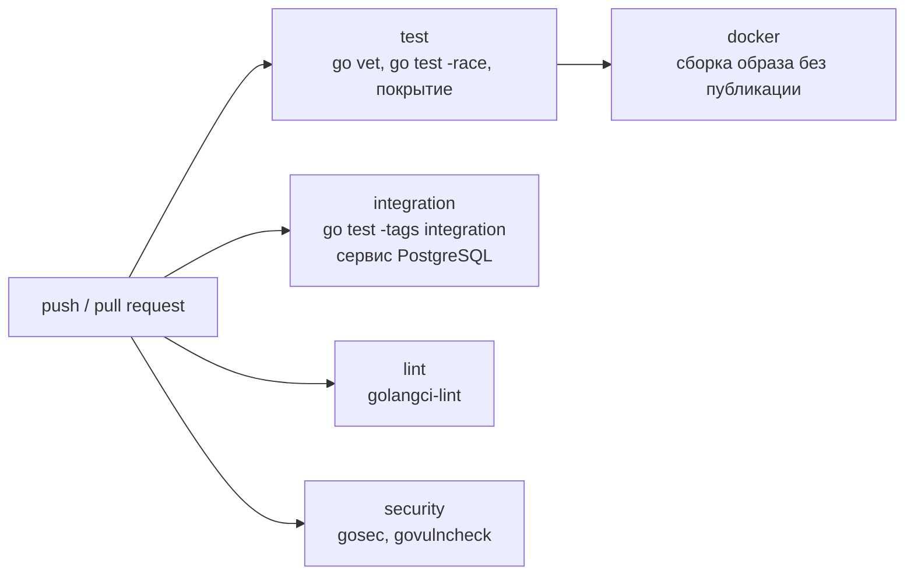

# 3 Технологическая часть

## 3.1 Язык программирования Go

Для реализации выбран язык Go. Решающими стали следующие свойства [1, 10].

1. **Горутины и каналы.** Конвейер аналитики естественно выражается в модели взаимодействующих последовательных процессов: обработчик HTTP помещает событие в буферизованный канал, а пул горутин-воркеров читает его, обогащает и пакетно записывает. Горутина занимает единицы килобайт памяти, планировщик среды выполнения мультиплексирует их на потоки ОС, поэтому тысячи одновременных соединений не требуют пула потоков и асинхронных обратных вызовов. Неблокирующая отправка (`select` с веткой `default`) позволяет отбрасывать события при переполнении очереди, не задерживая редирект.
2. **Стандартная библиотека.** Пакет `net/http` содержит промышленный HTTP-сервер. Начиная с Go 1.22 мультиплексор поддерживает маршрутизацию по методу и шаблону пути (`GET /api/v1/links/{code}`) с извлечением параметров, что позволило обойтись без сторонних маршрутизаторов. Пакеты `log/slog` (структурированные журналы), `crypto/rand`, `crypto/hmac`, `crypto/sha256`, `embed` (встраивание дашборда в бинарный файл), `context` (отмена и сроки) также входят в стандартную поставку. Проект использует версию Go 1.27 (в `go.mod` указана 1.27.1); минимально необходимой для шаблонной маршрутизации является версия 1.22.
3. **Статическая сборка.** Результатом сборки является один исполняемый файл без зависимостей от среды выполнения, что позволяет использовать минимальный образ `distroless` и упрощает развёртывание.
4. **Производительность.** Компилируемый код с автоматическим управлением памятью и сравнительно короткими паузами сборщика мусора обеспечивает высокую пропускную способность для задач ввода-вывода, характерных для редиректа.
5. **Инструментарий.** Встроенные средства тестирования (`go test`, детектор гонок `-race`, замеры покрытия), форматирования (`gofmt`), статического анализа (`go vet`) и управления зависимостями (модули) снижают затраты на настройку проекта.

Для сравнения рассмотрены альтернативные платформы (таблица 3.1). Оценки качественные и отражают типичные свойства технологий; точные значения зависят от конкретной реализации и нагрузки.

Таблица 3.1 — Сравнение платформ реализации

| Критерий | Go | Python / FastAPI | Rust / Actix | Node.js |
|---|---|---|---|---|
| Модель параллелизма | горутины и каналы, многопоточность из коробки | асинхронность `asyncio`, ограничение GIL для CPU-задач | потоки и async/await (tokio), безопасность памяти на этапе компиляции | однопоточный цикл событий, воркеры для CPU-задач |
| Пропускная способность на задачах ввода-вывода | высокая | средняя | очень высокая | высокая |
| Порог входа | низкий | очень низкий | высокий (владение, времена жизни) | низкий |
| Поставка | один статический файл | интерпретатор и зависимости | один файл | среда выполнения и `node_modules` |
| Типизация | статическая | динамическая с подсказками типов | статическая, строгая | динамическая (или TypeScript) |
| Потребление памяти | умеренное | выше | минимальное | умеренное |
| Скорость разработки | высокая | очень высокая | ниже | высокая |
| Экосистема для веб-сервисов | зрелая, богатая stdlib | очень обширная | развивающаяся | очень обширная |

Python/FastAPI уступает по пропускной способности и требует развёртывания интерпретатора и зависимостей; Rust/Actix даёт наилучшую производительность, но существенно повышает трудоёмкость разработки, что неоправданно для учебного проекта с нагрузкой, ограничиваемой скорее вводом-выводом, чем вычислениями; Node.js сопоставим по модели ввода-вывода, но уступает в простоте параллельной обработки CPU-операций (bcrypt, хэширование) и в статической типизации без TypeScript. Go представляет разумный компромисс между производительностью, простотой и скоростью разработки.

## 3.2 PostgreSQL

В качестве основного хранилища выбрана СУБД PostgreSQL [11] по следующим причинам.

- **ACID и целостность.** Транзакции, внешние ключи, ограничения `UNIQUE` и `NOT NULL` на уровне СУБД критичны для сервиса: уникальность кодов гарантируется базой данных и обеспечивает корректность при конкурентных запросах, а не логикой приложения.
- **Индексы.** Поддержка B-tree по умолчанию, составных и убывающих индексов, что используется в схеме (раздел 2.4).
- **Пакетная вставка.** Протокол `COPY` и многострочные вставки позволяют записывать сотни событий одной командой; в проекте пакет переходов записывается методом `CopyFrom` драйвера pgx (`COPY clicks ... FROM STDIN`), что снижает накладные расходы на сетевые обращения и фиксацию транзакций.
- **Агрегатные запросы.** `GROUP BY`, `date_trunc`, `count(DISTINCT ...)` позволяют вычислять статистику по дням, странам и источникам средствами СУБД.
- **Зрелость и открытость.** Свободная лицензия, развитая экосистема, поддержка секционирования таблиц для роста данных.

Реляционная модель соответствует связям «пользователь — ссылки — переходы» и потребности в агрегатных запросах; документоориентированные хранилища потребовали бы реализации агрегирования на стороне приложения.

### 3.2.1 Драйвер: pgx и database/sql

Для доступа к PostgreSQL применяется драйвер `pgx` версии 5 с пулом соединений `pgxpool` [13]. Сравнение с интерфейсом стандартной библиотеки `database/sql` приведено в таблице 3.2.

Таблица 3.2 — Сравнение pgx и database/sql

| Критерий | pgx (native) | database/sql (+ драйвер) |
|---|---|---|
| Интерфейс | специфичный для PostgreSQL | универсальный |
| Пул соединений | `pgxpool` встроен | встроен в `database/sql` |
| Бинарный протокол и типы PostgreSQL | да, прямое сопоставление | через слой совместимости |
| `COPY FROM` | поддерживается | недоступен через универсальный интерфейс |
| Пакетная отправка запросов (batch) | да | нет |
| Переносимость на другую СУБД | нет | да |

Поскольку проект ориентирован на PostgreSQL и использует пакетные операции, выбран нативный интерфейс `pgx`; переносимость между СУБД не требуется, а доступ к возможностям протокола полезен для записи аналитики. Схема изменяется через пронумерованные SQL-миграции, встроенные в бинарный файл (`embed`) и применяемые при запуске с учётом таблицы `schema_migrations` (её создаёт сам код применения миграций). Применение выполняется в одной транзакции под рекомендательной блокировкой `pg_advisory_xact_lock`, поэтому одновременный запуск нескольких экземпляров приложения не приводит к двойному применению.

## 3.3 Redis

Redis [7, 12] — in-memory хранилище структур данных; в системе он выполняет три роли.

- **Кэш ссылок.** Хранение в оперативной памяти даёт задержки порядка долей миллисекунды; команда `SET` с `EX` задаёт время жизни, а политика `allkeys-lru` автоматически вытесняет редкие ключи.
- **Счётчики популярности.** Команда `INCR` атомарна, поэтому конкурентные обращения не приводят к потерянным обновлениям; вместе с `EXPIRE` она реализует окно подсчёта.
- **Рейтинг.** Отсортированные множества (sorted sets) позволяют поддерживать и получать топ кодов по убыванию счёта за логарифмическое время.

Для работы с Redis используется клиент `go-redis` версии 9 [14]: поддерживает пул соединений, контексты и конвейеризацию команд. Тестирование выполняется на встроенной имитации сервера `miniredis` (v2.40.0), что позволяет запускать модульные тесты без реального Redis. Альтернатива — Memcached — не поддерживает богатых структур данных и атомарных счётчиков с тем же набором возможностей, поэтому не обеспечила бы рейтинг и счётчики популярности.

## 3.4 Аутентификация: bcrypt и HMAC-токены

**Хэширование паролей.** Пароли хэшируются алгоритмом bcrypt (пакет `golang.org/x/crypto/bcrypt`) с параметром стоимости 12 в промышленной конфигурации и минимальной стоимостью в тестах. Bcrypt является адаптивной функцией с солью, замедляющей перебор; параметр стоимости позволяет повышать вычислительную сложность по мере роста мощности оборудования. Альтернативы (scrypt, Argon2id) обладают дополнительной стойкостью к атакам на специализированном оборудовании, однако bcrypt остаётся приемлемым и широко поддерживаемым вариантом.

**Токены.** Токен доступа имеет вид `base64url(userID.expUnix).base64url(HMAC-SHA256(secret, payload))` и подписывается секретом сервера. Проверка выполняется сравнением подписи за постоянное время (`hmac.Equal`) и контролем срока действия. Сравнение с JWT приведено в таблице 3.3.

Таблица 3.3 — Сравнение собственных HMAC-токенов и JWT

| Критерий | HMAC-токен проекта | JWT |
|---|---|---|
| Зависимости | только стандартная библиотека | внешняя библиотека |
| Сложность формата | минимальная: идентификатор, срок, подпись | заголовок, полезная нагрузка, подпись; множество алгоритмов |
| Риск ошибок конфигурации | подпись всегда HMAC-SHA256, выбор алгоритма клиентом невозможен | известные классы уязвимостей: `alg=none`, подмена алгоритма (RS256/HS256) при некорректной проверке |
| Интероперабельность | только внутреннее использование | стандарт (RFC 7519), поддержка в разных системах |
| Отзыв токена | только по истечении срока (или смене секрета) | то же без дополнительного хранилища |
| Ключевая ротация, `kid`, стороннее подтверждение | не поддерживается | поддерживается |

Поскольку единственным потребителем токена является само приложение, а набор нужных утверждений минимален, выбран самодостаточный HMAC-токен: он проще проверяется, не требует сторонних библиотек и исключает класс атак, связанных с выбором алгоритма в заголовке. Подпись по алгоритму HMAC [9] вычисляется из общего секрета. Ограничением является отсутствие стандартизованной интероперабельности и механизма отзыва; для распределённых систем с несколькими издателями токенов предпочтительнее JWT с жёсткой проверкой алгоритма.

## 3.5 Контейнеризация и непрерывная интеграция

**Docker и Compose.** Контейнеризация обеспечивает воспроизводимость окружения и позволяет запустить систему вместе с зависимостями командой `docker compose up`. Подробно архитектура развёртывания описана в разделе 2.8 [15].

**GitHub Actions.** Конвейер непрерывной интеграции [16] запускается при каждом `push` и `pull request` и состоит из независимых заданий (рисунок 3.1).

Рисунок 3.1 — Конвейер непрерывной интеграции

Задание `test` выполняет `go vet` и тесты с детектором гонок и сохраняет отчёт о покрытии как артефакт. Задание `integration` поднимает контейнер PostgreSQL в качестве сервиса GitHub Actions и выполняет тесты с тегом `integration`, проверяющие реализацию хранилища на реальной СУБД. Задание `lint` запускает `golangci-lint`, `security` — анализаторы безопасности, `docker` проверяет, что образ собирается. Права токена конвейера ограничены чтением содержимого (`permissions: contents: read`) в соответствии с принципом минимальных привилегий.

## 3.6 Инструменты контроля качества и безопасности

Перечень применяемых инструментов приведён в таблице 3.4.

Таблица 3.4 — Инструменты качества и безопасности

| Инструмент | Тип | Назначение |
|---|---|---|
| `gofmt` | форматирование | единый стиль кода |
| `go vet` | статический анализ | типовые ошибки: неверные форматные строки, копирование блокировок и др. |
| `golangci-lint` | агрегатор линтеров | `errcheck`, `staticcheck`, `govet`, `ineffassign`, `unused`, `gosec`, `bodyclose`, `misspell`, `revive`, `gocritic` (конфигурация `.golangci.yml`) |
| `gosec` | SAST | поиск небезопасных конструкций: слабая криптография, жёстко заданные секреты, небезопасные разрешения |
| `govulncheck` | SCA | поиск известных уязвимостей в зависимостях и стандартной библиотеке с учётом достижимости уязвимого кода |
| Dependabot | автоматическое обновление | еженедельные предложения обновления модулей Go, действий GitHub Actions и базовых образов Docker |
| `go test -race` | динамический анализ | обнаружение гонок данных |

Сочетание SAST, SCA и динамического анализа покрывает основные классы дефектов, выявляемых автоматически. Необходимо отметить, что автоматические средства не заменяют ручного ревью и модели угроз; они уменьшают вероятность регрессий и известных уязвимостей [3, 17]. Тестирование организовано по уровням: модульные тесты каждого пакета без внешних сервисов (реализации хранилища и кэша в памяти, `miniredis`), интеграционные тесты хранилища PostgreSQL под тегом `integration` микробенчмарки, нагрузочный генератор `cmd/loadgen` и подготовленный сценарий k6 для проверки производительности редиректа.

Фактические версии языка и внешних зависимостей, зафиксированные в `go.mod`, приведены в таблице 3.5. Набор зависимостей намеренно невелик: маршрутизация, журналирование, HMAC и встраивание статики используют стандартную библиотеку.

Таблица 3.5 — Версии языка и зависимостей

| Компонент | Версия | Назначение |
|---|---|---|
| Go | 1.27 (директива `go 1.27.1`) | язык и стандартная библиотека |
| `github.com/jackc/pgx/v5` | v5.11.0 | драйвер и пул соединений PostgreSQL, `CopyFrom` |
| `github.com/redis/go-redis/v9` | v9.23.0 | клиент Redis |
| `golang.org/x/crypto` | v0.58.0 | bcrypt |
| `github.com/oschwald/maxminddb-golang` | v1.13.1 | чтение базы GeoLite2 |
| `github.com/alicebob/miniredis/v2` | v2.40.0 | имитация Redis в тестах |

## 3.7 Использование AI-ассистентов в разработке

В процессе разработки использовался ИИ-ассистент Claude Code. Его применение было ограничено вспомогательными задачами: генерацией каркаса проекта и типового кода (репозитории, middleware, конфигурация), написанием черновиков тестов, подготовкой черновиков документации и предварительным ревью. Для параллельной разработки применялась схема, при которой несколько экземпляров ассистента работали над отдельными пакетами, опираясь на общий контракт — документ `docs/DESIGN.md` и уже готовые интерфейсы (`model`, `storage`, `cache`, `analytics.Tracker`, `service`). Фиксация интерфейсов заранее позволила независимо реализовывать пакеты и затем собирать их без существенных конфликтов.

Ответственность за архитектурные решения (слоистая структура, асинхронный конвейер аналитики, политика кэширования, выбор технологий), за постановку требований и приёмку результата остаётся на разработчике. Сгенерированный код подвергался проверке: чтению, запуску тестов и линтеров, анализу граничных случаев и вопросов безопасности. Опыт показывает, что ассистент ускоряет выполнение рутинных операций, однако может допускать неточности и предлагать избыточные или устаревшие решения, поэтому результаты не принимались без проверки, а текст настоящей записки сверялся с исходным кодом.

## 3.8 Выводы по главе 3

1. Go выбран за модель параллелизма, подходящую для конвейера аналитики, богатую стандартную библиотеку с маршрутизацией по шаблонам и статическую сборку; приведено сравнение с Python/FastAPI, Rust/Actix и Node.js.
2. PostgreSQL обеспечивает целостность и агрегатные запросы, Redis — быстрый кэш, атомарные счётчики и рейтинг; драйверы pgx и go-redis дают доступ к специфичным возможностям СУБД.
3. Аутентификация реализована на bcrypt и подписанных HMAC-токенах, что упрощает систему и исключает ряд уязвимостей, типичных для JWT, ценой отсутствия стандартной интероперабельности.
4. Контейнеризация, конвейер GitHub Actions и набор инструментов (golangci-lint, gosec, govulncheck, Dependabot) обеспечивают воспроизводимость сборки и автоматический контроль качества и безопасности.
5. Использование AI-ассистента ограничено вспомогательными задачами при сохранении ответственности разработчика за архитектуру и проверку результатов.
