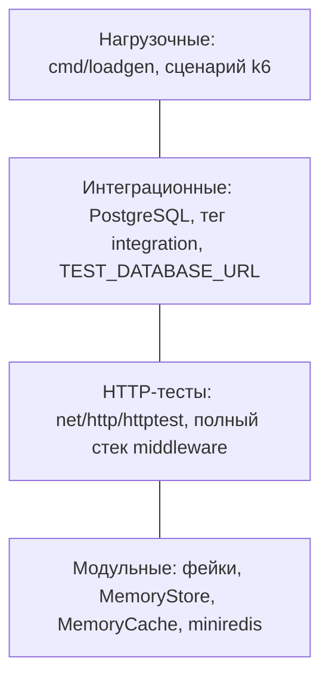

# 5 Тестирование

## 5.1 Стратегия тестирования

Тестирование организовано по принципу пирамиды: основание составляет большое число быстрых модульных тестов, не требующих внешних сервисов, выше расположены интеграционные тесты хранилища на реальной СУБД, ещё выше — немногочисленные сквозные и нагрузочные проверки (рисунок 5.1).

Рисунок 5.1 — Пирамида тестирования

Уровни имеют следующие особенности.

1. **Модульные тесты.** Каждый пакет тестируется изолированно. Зависимости заменяются фейками или лёгкими реализациями: хранилище в памяти (`storage/memory`), кэш в памяти, имитация Redis `miniredis` для `RedisCache`, подставные репозитории и счётчики для `Collector`. Время внедряется через поле `now`, что позволяет проверять истечение срока ссылок и токенов без пауз. Тесты на таблицах случаев (`table-driven`) охватывают граничные значения.
2. **Интеграционные тесты** хранилища PostgreSQL помечены тегом сборки `integration` и используют строку подключения из переменной `TEST_DATABASE_URL`; при её отсутствии пропускаются. В конвейере CI для них поднимается контейнер `postgres:17-alpine`. Они проверяют миграции, ограничения уникальности, `COPY`-вставку и SQL-запросы статистики, которые невозможно проверить на реализации в памяти.
3. **HTTP-тесты** используют `httptest`: поднимается полный обработчик со всеми middleware, а запросы проверяют коды ответов, заголовки и тела JSON.
4. **Бенчмарки** (`testing.B`) измеряют путь разрешения ссылки и обработчик редиректа.
5. **Нагрузочное тестирование** выполняется генератором `cmd/loadgen`; для запуска в окружении Compose подготовлен сценарий k6.

В конвейере CI модульные тесты выполняются с детектором гонок (`go test -race`), что важно для кода с каналами, блокировками и атомарными счётчиками.

## 5.2 Результаты модульного тестирования и покрытие

Тесты выполнены командой `go test -count=1 -cover ./...` на машине разработки (Go 1.27.1, Windows 11). Все 71 функция верхнего уровня (169 тестов с учётом подтестов) завершились успешно. Покрытие операторов по пакетам приведено в таблице 5.1.

Таблица 5.1 — Покрытие кода тестами по пакетам

| Пакет | Назначение | Покрытие операторов, % |
|---|---|---|
| `internal/service` | бизнес-логика ссылок | 100,0 |
| `internal/storage/memory` | хранилище в памяти | 99,3 |
| `internal/shortcode` | генерация кодов, алиасы | 96,9 |
| `internal/httpapi` | обработчики, middleware, rate limiting | 91,0 |
| `internal/config` | конфигурация | 90,2 |
| `internal/auth` | регистрация, вход, токены | 89,3 |
| `internal/analytics` | сборщик, User-Agent, реферер | 84,8 |
| `internal/cache` | `MemoryCache`, `RedisCache` (на miniredis) | 81,5 |
| `internal/storage/postgres` | хранилище PostgreSQL | 0,0 при обычном запуске; тесты — в задании `integration` |
| `internal/model`, `cmd/shortener`, `cmd/loadgen` | структуры данных, точки входа | 0,0 (тестов нет) |

Суммарное покрытие по всем пакетам при обычном запуске составило 68,4 %. Если исключить пакеты без модульных тестов (`model`, `cmd/*`) и пакет `postgres`, проверяемый отдельно в интеграционном режиме, суммарное покрытие остальных пакетов равно 91,5 %. Нулевое покрытие `storage/postgres` в таблице — следствие того, что на машине разработки PostgreSQL не установлен и интеграционные тесты пропускаются (при запуске с тегом `integration` без `TEST_DATABASE_URL` они завершаются как пропущенные); покрытие этого пакета в настоящей записке не измерялось, а проверка его работоспособности выполняется заданием `integration` конвейера CI. Низкое покрытие `cmd/` типично для точек входа и компенсируется запуском сервиса при замерах производительности.

Следует отметить, что покрытие операторов показывает лишь, какие строки были выполнены, но не гарантирует качества проверок; поэтому в дополнение к нему тесты содержат проверки отрицательных сценариев и граничных значений (таблица 5.2).

## 5.3 Ключевые тест-кейсы

Перечень основных проверок по пакетам приведён в таблице 5.2.

Таблица 5.2 — Ключевые тест-кейсы

| Пакет | Что проверяется | Ожидаемый результат |
|---|---|---|
| `shortcode` | длина и алфавит кодов (`TestRandomLengthAndAlphabet`) | код заданной длины из символов `0-9A-Za-z` |
| `shortcode` | отсутствие коллизий на большой выборке (`TestRandomNoCollisions`) | повторов нет |
| `shortcode` | равномерность символов, 50 000 кодов (`TestRandomUniform`) | частота каждого символа в пределах ±10 % от ожидаемой |
| `shortcode` | алиасы: длина, допустимые символы, начало с `-`/`_`, зарезервированные (`TestValidateAlias`) | соответствующие ошибки, допустимые алиасы принимаются |
| `service` | создание ссылки: нормализация схемы и хоста, пустой и слишком длинный адрес, `ftp`, `javascript:`, адрес без хоста, адрес на собственный хост (в том числе с портом), `expires_at` в прошлом (`TestCreate`) | `ErrInvalidURL` либо нормализованный адрес |
| `service` | коллизии кода при генерации (`TestCreate_Collisions`) | повторная генерация; после пяти неудач — ошибка |
| `service` | занятый алиас (`TestCreate_AliasTaken`) | `ErrAliasTaken` |
| `service` | кэш только для популярных ссылок (`TestResolve_CacheOnlyWhenPopular`) | запись попадает в кэш после порога обращений |
| `service` | TTL кэша не превышает оставшийся срок ссылки (`TestResolve_CacheTTL`) | TTL = min(`CacheTTL`, остаток срока) |
| `service` | отказ кэша (`TestResolve_DegradedCache`) | редирект работает из хранилища |
| `service` | просроченная запись в кэше (`TestResolve_CachedEntryExpired`) | `ErrGone` |
| `service` | повторное удаление (`TestDelete_Twice`), ошибка кэша при удалении | `ErrNotFound`; ошибка кэша не ломает удаление |
| `service` | недопустимый код не доходит до хранилища (`TestResolve_InvalidCodeSkipsStore`) | `ErrNotFound` без обращения к хранилищу |
| `service` | `hostOnly` для `example.com:8080`, `[::1]:8080`, `[::1]` (`TestHostOnly`) | хост без порта и скобок |
| `auth` | регистрация, вход, дубликат, слабый пароль, неверные учётные данные | успех / `ErrEmailTaken` / `ErrWeakPassword` / `ErrInvalidCredentials` |
| `auth` | токен: подмена полезной нагрузки, чужой ключ, пустой, без разделителя, мусор, срок действия (`TestToken`) | `ErrInvalidToken`; токен действителен до момента истечения и недействителен после |
| `analytics` | разбор User-Agent и реферера, порядок проверок браузеров | правильные браузер, ОС, устройство, домен источника |
| `analytics` | обогащение события (`TestEnrich`) | страна из подсказки, из GeoIP или `ZZ`; `VisitorID` из 16 символов, зависит от IP |
| `analytics` | пакетирование по размеру и по таймеру | пакеты записываются при достижении `BatchSize` и по `FlushInterval` |
| `analytics` | дренаж при остановке (`TestCollectorDrainOnStop`) | записаны все 100 событий; после остановки `Track` отбрасывает событие |
| `analytics` | переполнение очереди (`TestCollectorDropsOnOverflow`) | `Accepted` = 2, `Dropped` = 3 при буфере 2 и пяти событиях |
| `analytics` | сбой записи (`TestCollectorWriteFailure`) | растёт `Failed`, `Written` = 0 |
| `cache` | `MemoryCache` и `RedisCache` (miniredis): Get/Set/Delete, TTL, окно счётчика, топ | идентичное поведение двух реализаций |
| `config` | значения по умолчанию, обязательность `AUTH_SECRET` при `DATABASE_URL`, некорректные значения | корректная конфигурация либо агрегированная ошибка |
| `storage/memory` | создание, копии, список, деактивация, пользователи, счётчики, статистика, конкурентный доступ (`TestConcurrent`) | корректные данные; отсутствие гонок |
| `httpapi` | регистрация и вход, создание ссылки, слишком большое тело (`TestBodyTooLarge`) | 201 / 200 / 413 |
| `httpapi` | редирект, 404 и 410 (`TestRedirect*`) | `302` с `Location` и `Cache-Control`; 404; 410 |
| `httpapi` | чужие ссылки (`TestListGetDeleteOwnership`) | `404` на чужую ссылку |
| `httpapi` | запрос без токена (`TestUnauthorized`) | `401` с `WWW-Authenticate` |
| `httpapi` | rate limiting (`TestRateLimit`) | при burst = 3 коды 401, 401, 401, 429, 429; заголовок `Retry-After`; `/healthz` не лимитируется |
| `httpapi` | заголовки безопасности и дашборд (`TestDashboardAndHeaders`) | `nosniff`, `DENY`, CSP с `default-src 'self'`, `X-Request-Id`; корень перенаправляет на `/dashboard/` |
| `httpapi` | `/healthz` и `/metrics` | `200` / `503` при отказе зависимости; счётчики в формате Prometheus |
| `httpapi` | определение IP (`TestClientIP`) | `X-Forwarded-For` учитывается только при доверии; мусор в заголовке игнорируется |
| `storage/postgres` (интеграционные) | идемпотентность миграций, пользователи и ссылки, ограничения уникальности, статистика | результаты совпадают с реализацией в памяти |

## 5.4 Дефекты, найденные тестами

В ходе тестирования выявлены и исправлены следующие дефекты.

1. **Повторное удаление ссылки возвращало успех вместо 404.** Метод `Deactivate` в хранилищах (в памяти и PostgreSQL) не учитывал флаг `is_active`: для уже деактивированной ссылки операция повторно «успешно» обновляла строку. Исправление: в PostgreSQL условие `WHERE` дополнено `AND is_active` (операция затрагивает ноль строк и возвращает `ErrNotFound`), в хранилище в памяти добавлена аналогичная проверка. Дефект обнаружен тестом `TestDelete_Twice`, а в слое хранилища — тестами `TestDeactivate`.
2. **Проверка ссылки на собственный хост не работала для IPv6-адресов.** Функция `hostOnly`, выделяющая имя хоста из `BASE_URL`, не снимала квадратные скобки, поэтому для `[::1]:8080` возвращалось `[::1]`, тогда как `url.URL.Hostname()` для проверяемого адреса возвращает `::1`; сравнение не срабатывало, и можно было создать ссылку на сам сервис. Исправление: реализация заменена вызовом `(&url.URL{Host: h}).Hostname()`; случаи `[::1]:8080` и `[::1]` добавлены в `TestHostOnly`.
3. **Конфликт имён методов `Create` во встроенных интерфейсах.** Интерфейс `Store` встраивает `LinkRepository` и `UserRepository`; оба объявляли метод `Create` с разными сигнатурами, из-за чего контракт не компилировался. Метод создания пользователя переименован в `CreateUser`. Дефект выявлен на этапе проверки контрактов интерфейсов при сборке пакетов, разработанных независимо, и подтверждает ценность фиксации интерфейсов до реализации (раздел 3.7).

## 5.5 Статический анализ и безопасность

**go vet.** Команда `go vet ./...` не выдала замечаний.

**govulncheck.** Проверка выявила 13 уязвимостей стандартной библиотеки версии go1.27.1. Десять из них (GO-2026-6603, GO-2026-6605, GO-2026-6607, GO-2026-6608, GO-2026-6609, GO-2026-6610, GO-2026-6611, GO-2026-6612, GO-2026-6613, GO-2026-6617) достижимы из кода проекта через пакеты `net/http`, `net/http/internal/http2`, `crypto/tls` и `net/textproto`. Ещё одна (GO-2026-6604, пакет `os`) находится в импортируемом пакете, а две (GO-2026-6599, GO-2026-6600) — в модуле стандартной библиотеки, но уязвимые функции проектом не вызываются. Все 13 исправлены в версии go1.27.2. Уязвимости устранены фиксацией директивы `toolchain go1.27.2` в `go.mod`: при установленном go1.27.1 команда `go` автоматически переключается на исправленную инструментальную цепочку. Дополнительно конвейер CI устанавливает последний патч ветки 1.27 (`go-version: "1.27.x"`, `check-latest: true`). Повторный запуск `govulncheck` на go1.27.2 показал 0 уязвимостей, достижимых из кода проекта, и 0 — в импортируемых пакетах. Это показывает практическую ценность проверки: уязвимости находились не в зависимостях проекта, а в самой стандартной библиотеке, и закрываются обновлением инструментальной цепочки.

Дополнительно обнаружена одна уязвимость в модуле `golang.org/x/crypto` (GO-2026-5932). Исправленной версии на момент проверки не существует, при этом анализ достижимости показал, что уязвимый код проектом не вызывается. Риск принят; обновления модуля отслеживаются Dependabot, а проверка `govulncheck` выполняется в каждом прогоне конвейера CI.

**gosec и golangci-lint.** Анализаторы `gosec` и `golangci-lint` (набор линтеров приведён в таблице 3.4) выполняются в заданиях `security` и `lint` конвейера CI; локально они запускаются по мере доступности (`make lint`, `make sec`), поэтому их результаты в настоящей записке не приводятся.

### 5.5.1 Угрозы и меры

Соответствие угроз по OWASP [17], принятых в разделе 1.4.3, реализованным мерам и проверяющим их тестам показано в таблице 5.3.

Таблица 5.3 — Угрозы, меры защиты и их проверка

| Угроза | Мера в реализации | Проверка |
|---|---|---|
| Открытое перенаправление [18] | допускаются только схемы `http` и `https`; запрещены ссылки на собственный хост (с учётом порта и IPv6); адрес обязательно создаёт аутентифицированный владелец; ссылку можно деактивировать; rate limiting на создание | `TestCreate` (схемы `ftp`, `javascript:`, собственный хост), `TestHostOnly` |
| Межсайтовый скриптинг (XSS) в дашборде | вывод пользовательских данных только через `textContent`, `innerHTML` не применяется; CSP `script-src 'self'`; `X-Content-Type-Options: nosniff` | `TestDashboardAndHeaders`; просмотр исходного кода `app.js` |
| Перебор паролей | rate limiting по IP на `/auth/login` и `/auth/register`; bcrypt со стоимостью 12; единое сообщение об ошибке и выравнивание времени ответа при неизвестном email | `TestRateLimit`, `TestLoginFailures` |
| SQL-инъекции | параметризованные запросы pgx; запросы разрезов — константы | просмотр кода, интеграционные тесты |
| Подделка токена | подпись HMAC-SHA256, сравнение `hmac.Equal`, срок действия; подпись проверяется до разбора полезной нагрузки | `TestToken` (подмена, чужой ключ, срок) |
| Доступ к чужим ссылкам | проверка `owner_id`; чужая ссылка неотличима от отсутствующей | `TestListGetDeleteOwnership` |
| Подмена IP и страны | `X-Forwarded-For` и `CF-IPCountry` учитываются только при `TRUST_PROXY=true` | `TestClientIP` |
| Большие тела запросов | ограничение 64 КБ (`http.MaxBytesReader`) | `TestBodyTooLarge` |
| Перегрузка очереди аналитики | неблокирующая постановка, счётчик потерь | `TestCollectorDropsOnOverflow` |
| Уязвимые зависимости | `govulncheck`, `gosec`, Dependabot в CI | раздел 5.5 |

Остаточные риски: ограничение частоты хранится в памяти процесса и не действует на редиректы; токен не отзывается до истечения срока действия и хранится в `localStorage`; при регистрации ответ `409` раскрывает факт существования адреса; сервис не проверяет адреса по базам вредоносных ресурсов. Эти ограничения перечислены в заключении как направления развития.

## 5.6 Производительность

### 5.6.1 Стенд

Замеры выполнены реальными запусками на стенде, описанном в таблице 5.4. Каждый замер выполнен один раз, без усреднения по нескольким запускам; значения зависят от загрузки машины.

Таблица 5.4 — Стенд для замеров производительности

| Параметр | Значение |
|---|---|
| Процессор | AMD Ryzen 5 5600H with Radeon Graphics, 6 ядер / 12 потоков, максимальная частота 3301 МГц |
| Оперативная память | 15,4 ГБ |
| Операционная система | Microsoft Windows 11 Pro 10.0.26300 |
| Go | go1.27.1 windows/amd64 |
| Режим сервиса | демонстрационный: хранилище и кэш в памяти, без PostgreSQL и Redis |
| Нагрузочный клиент | `cmd/loadgen` на той же машине, через loopback (127.0.0.1) |

Сервис и генератор нагрузки работают на одной машине и делят ядра процессора; журнал доступа (JSON, по строке на запрос) писался в файл. Поэтому абсолютные значения RPS следует рассматривать как оценку снизу для данной конфигурации, а не как предел самого приложения.

### 5.6.2 Микробенчмарки

Команда запуска: `go test -run='^$' -bench=. -benchmem ./internal/service/ ./internal/httpapi/`. Суффикс `-12` в именах означает `GOMAXPROCS=12`; варианты `Parallel` используют `b.RunParallel`. Результаты для сервисного слоя (хранилище — `memory.New()`, кэш — `cache.NewMemory()`, генератор — `shortcode.NewRandom(7)`, трекер — заглушка) приведены в таблице 5.5.

Таблица 5.5 — Бенчмарки сервисного слоя

| Бенчмарк | Итераций | нс/оп | Б/оп | аллокаций/оп |
|---|---:|---:|---:|---:|
| `ResolveCacheHit` (попадание в кэш) | 21 291 582 | 57,74 | 32 | 1 |
| `ResolveCacheHitParallel` | 9 499 104 | 135,1 | 32 | 1 |
| `ResolveCacheMiss` (промах, чтение из хранилища в памяти) | 8 512 551 | 135,4 | 144 | 2 |
| `ResolveCacheMissParallel` | 13 014 986 | 99,52 | 144 | 2 |
| `CreateRandomCode` | 1 000 000 | 2927 | 610 | 5 |
| `CreateRandomCodeParallel` | 1 000 000 | 1957 | 611 | 5 |

Разрешение закэшированной ссылки в сервисном слое занимает около 58 нс и одну аллокацию. У варианта `ResolveCacheHitParallel` время на операцию выше, чем у последовательного (135 против 58 нс): все горутины конкурируют за общую блокировку кэша в памяти; для Redis конкуренция происходит на уровне сети и сервера Redis, поэтому этот результат относится только к реализации в памяти. Создание ссылки со случайным кодом (около 3 мкс) определяется обращением к `crypto/rand` и аллокациями.

Бенчмарки HTTP-слоя измеряют полный стек: middleware (идентификатор запроса, восстановление после паники, журнал доступа, заголовки безопасности), маршрутизатор, `Resolve` и ответ `302`; хранилище и аутентификатор — фейки из тестов (таблица 5.6).

Таблица 5.6 — Бенчмарки HTTP-слоя

| Бенчмарк | Итераций | нс/оп | Б/оп | аллокаций/оп |
|---|---:|---:|---:|---:|
| `RedirectHandlerCacheHit` (`ResponseRecorder`, без сети) | 132 022 | 10 255 | 7202 | 33 |
| `RedirectHandlerCacheHitParallel` | 217 141 | 6330 | 7229 | 33 |
| `RedirectHandlerCacheMiss` (кэш всегда промахивается) | 133 950 | 9134 | 7314 | 34 |
| `RedirectHTTPLoopback` (`httptest.NewServer`, параллельный клиент) | 39 334 | 33 408 | 8410 | 95 |

Сопоставление таблиц показывает, что работа самой бизнес-логики (около 58 нс при попадании в кэш) составляет доли процента от стоимости обработки запроса в HTTP-слое (около 10 мкс без сети и около 33 мкс через loopback). Накладные расходы стека `net/http`, middleware, формирования записи журнала доступа и аллокаций (около 33 на запрос) доминируют, поэтому оптимизация алгоритма кэширования сама по себе почти не влияет на пропускную способность. Различие между попаданием и промахом на уровне HTTP (10,3 против 9,1 мкс) лежит в пределах погрешности однократного замера.

### 5.6.3 Нагрузочный тест

Сервис собран и запущен в демонстрационном режиме (`HTTP_ADDR=127.0.0.1:8091`), генератор — командой `loadgen -url http://127.0.0.1:8091/<код> -c <C> -d 10s`. Перед замерами зарегистрирован пользователь, создана ссылка (`POST /api/v1/links`) и выполнен прогрев — 10 запросов `GET /<код>`, все ответы `302`. Результаты для четырёх уровней конкурентности приведены в таблице 5.7.

Таблица 5.7 — Результаты нагрузочного теста редиректа (по 10 с на уровень)

| c | Запросов | RPS | p50 | p90 | p95 | p99 | max | Ошибки транспорта |
|---:|---:|---:|---:|---:|---:|---:|---:|---:|
| 1 | 29 372 | 2937,1 | 520,9 мкс | 536,1 мкс | 555 мкс | 651,7 мкс | 29,92 мс | 0 |
| 16 | 56 103 | 5609,0 | 2,690 мс | 3,334 мс | 3,766 мс | 4,808 мс | 10,26 мс | 0 |
| 64 | 56 712 | 5665,4 | 11,17 мс | 12,82 мс | 13,50 мс | 14,89 мс | 28,46 мс | 0 |
| 256 | 56 181 | 5595,1 | 45,18 мс | 50,99 мс | 52,68 мс | 55,72 мс | 103,6 мс | 0 |

Все запросы получили ответ `302` (статусов, отличных от 302, не зафиксировано). По счётчикам `/metrics` после всех прогонов: редиректов 198 378, принято событий аналитики 198 378, отброшено 0; записано 196 863 на момент снятия метрик, остаток находился в очереди сборщика. Отсутствие отброшенных событий при пропускной способности около 5,6 тыс. запросов в секунду подтверждает, что буфер на 10 000 событий и пакетная запись справляются с потоком переходов.

**Анализ.** Пропускная способность перестаёт расти уже при c = 16 и остаётся около 5,6 тыс. запросов в секунду при дальнейшем увеличении конкурентности в 16 раз. При этом задержка растёт пропорционально числу одновременных запросов, что описывается законом Литтла: среднее число запросов в системе N = λ·W. Для c = 256 и λ ≈ 5595 запросов в секунду среднее время ответа W ≈ 256 / 5595 ≈ 45,8 мс, что согласуется с измеренным p50 = 45,18 мс; аналогично для c = 64 получаем 11,3 мс против 11,17 мс, для c = 16 — 2,85 мс против 2,69 мс. Следовательно, система перешла в режим насыщения: дополнительные запросы лишь ожидают в очереди, не увеличивая пропускной способности. Рост p99 при c = 256 (55,7 мс) также отражает очередь, а не деградацию обработки отдельного запроса.

Вероятными ограничителями являются следующие. Во-первых, синхронная запись JSON-строки журнала доступа на каждый запрос (в файл), выполняемая в потоке обработки; для служебного журнала в продуктивном окружении её целесообразно буферизовать или отключать для редиректов. Во-вторых, генератор нагрузки работает на той же машине и делит с сервисом ядра процессора и сетевой стек loopback; на Windows накладные расходы TCP-цикла существенны, чем объясняется задержка около 0,5 мс на запрос при c = 1. Микробенчмарки (таблицы 5.5 и 5.6) показывают, что чистая работа приложения на один запрос занимает единицы–десятки микросекунд, то есть на порядки меньше наблюдаемых задержек. Какой именно из факторов является основным, данными замерами не установлено, профилирование (`pprof`) не выполнялось. Тестирование с PostgreSQL и Redis, а также сценарием k6 (`docs/loadtest/k6-redirect.js`, порог p95 < 50 мс при 200 виртуальных пользователях) в рамках этих замеров не проводилось; результаты для реальных зависимостей будут отличаться: попадание в Redis добавляет сетевое обращение, а промах — запрос к PostgreSQL по уникальному индексу.

Требование НФТ-1 (разрешение популярной ссылки без обращения к основной СУБД, обработка на стороне сервиса за единицы миллисекунд) подтверждается в части, касающейся сервиса: при попадании в кэш обработка занимает десятки микросекунд, а при c ≤ 64 задержки по p99 не превышают 15 мс при клиенте на той же машине.

## 5.7 Выводы по главе 5

1. Применена многоуровневая стратегия: модульные тесты с фейками и `miniredis`, интеграционные тесты PostgreSQL под тегом `integration`, HTTP-тесты через `httptest`, бенчмарки и нагрузочный генератор. Все 71 функция тестов (169 с подтестами) проходят.
2. Покрытие операторов составляет от 81,5 до 100 % по пакетам с модульными тестами (91,5 % суммарно по ним); пакет PostgreSQL проверяется интеграционными тестами в конвейере CI.
3. Тестами выявлены и исправлены три дефекта: повторная деактивация ссылки, проверка собственного хоста для IPv6 и конфликт имён методов интерфейсов.
4. `go vet` не выдал замечаний; `govulncheck` выявил 13 уязвимостей стандартной библиотеки go1.27.1, устранённых переходом на go1.27.2, и одну уязвимость `golang.org/x/crypto`, не затрагивающую проект (риск принят и отслеживается).
5. Редирект на стенде при клиенте на той же машине достигает около 5,6 тыс. запросов в секунду, задержка растёт согласно закону Литтла; попадание в кэш в сервисном слое занимает около 58 нс, и в общих затратах доминирует стек HTTP.
